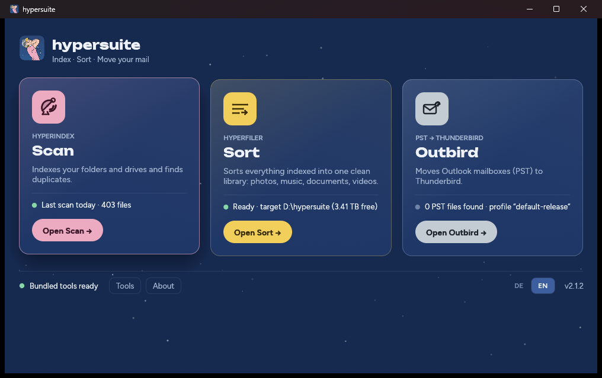

# hypersuite

**Index · Sort · Move your mail** — one Windows program that finds every file
on your drives, sorts them into one clean library, and moves Outlook mailboxes
to Thunderbird.

| App | What it does |
|---|---|
| **Scan** | Indexes your folders and drives (name, size, dates and a BLAKE3 checksum of every file) into a local database and finds duplicate files and folders — across every drive you have ever scanned, including USB sticks that are not plugged in today. |
| **Sort** | Copies everything indexed into one ordered library — photos by date and place, music by artist and album, documents by kind, videos by title — in four checked steps: Plan → Review → Apply → Verify. The originals stay where they are. |
| **Outbird** | Converts Outlook PST files into Thunderbird mail folders, or puts them straight into your Thunderbird profile (backed up first). |

Everything runs on your computer. hypersuite makes no network connections and
sends nothing anywhere; the document model, OCR (Tesseract, seven languages),
PDF rendering and music fingerprinting all ship inside the one exe.

## What it does to your files

hypersuite copies; it does not move or delete unless you ask it to, step by
step.

| | Reads | Writes | Moves or deletes |
|---|---|---|---|
| **Scan** | your folders | only its own database | nothing |
| **Duplicate reports** | the database | a Markdown + JSON report | nothing — the reports only recommend |
| **Sort: Plan, Review** | the database | a plan in the target folder | nothing — this is the dry run |
| **Sort: Apply, Verify** | your files | copies in the target library, each checked against its checksum | nothing — the originals stay where they are |
| **Sort: Quarantine** (optional) | library and originals | — | **moves** originals whose library copy checks out again into `<target>\.hyperfiler\quarantine\`, paths kept |
| **Sort: Purge** (optional) | quarantine | — | **deletes** quarantined files — only after you confirm a separate backup, never a file whose copy fails its check, no undo |
| **Outbird** | the PST, **read-only** | a new `<name>-thunderbird` folder next to it; into Thunderbird only after a full profile backup and a passed check, and never while Thunderbird is open | nothing in the PST; existing Thunderbird mail folders only with `--overwrite`, after the backup |

- **Duplicates** are files with the same size and the same BLAKE3 checksum of
  their entire content — no sampling, no name or date matching. A folder is
  only marked removable if every file in it exists elsewhere.
- **Dry runs:** Sort's plan shows where every file would go before anything
  is copied; on the command line `index apply`, `mail export` and `mail auto`
  take `--dry-run`.
- Apply, Verify and Quarantine compare against the checksums from the scan,
  so a copy that changed on the way is noticed, not trusted. Online-only
  OneDrive files are not downloaded unless you switch that on in Scan.

## Download

Get `hypersuite.exe` from the [latest release](https://github.com/namshubs/hypersuite/releases/latest). No
installer, no runtime to install, no administrator rights needed.

- **Windows 10 or 11, 64-bit.** About 230 MB download; on first start each
  version unpacks about 260 MB of bundled tools into your user profile.
- Each release also has `SHA256SUMS.txt`, the code-signing certificate
  `hypersuite-codesign.cer`, and `third-party-sources.zip` (source code of the
  bundled third-party components under GPL/LGPL).
- Each release's notes link the **VirusTotal** report of exactly that
  `hypersuite.exe` (by its SHA-256).

The exe is signed with a self-signed certificate, so Windows SmartScreen warns
the first time ("Windows protected your PC" → **More info** → **Run anyway**).
[Getting started](docs/getting-started.md) explains how to check the download
and, if you like, how to make Windows trust the signature.

## Documentation

- [Getting started](docs/getting-started.md) — download, verify, first start, update, uninstall
- [Scan](docs/scan.md) — indexing, the database, duplicates, photos, continuing an interrupted scan
- [Sort](docs/sort.md) — the library layout and the Plan → Review → Apply → Verify steps, quarantine and purge
- [Outbird](docs/outbird.md) — Outlook PST to Thunderbird
- [Command line](docs/command-line.md) — every command and option
- [Files, settings and privacy](docs/files-and-settings.md) — what is stored where
- [Troubleshooting](docs/troubleshooting.md)
- Deutsch: [Handbuch](docs/de/handbuch.md) · [Handbuch als PDF](docs/de/hypersuite-handbuch.pdf) · [Kurzanleitung](docs/de/README.md)

## Feedback

- **Found a bug?** [Open an issue](https://github.com/namshubs/hypersuite/issues/new/choose) with the bug report
  form. The version (`hypersuite --version`, or the About page) and the text
  under **Show details** help most.
- **Idea or question?** Use [Discussions](https://github.com/namshubs/hypersuite/discussions) or the feature
  request form.
- **Security problem?** Please don't open a public issue — see
  [SECURITY.md](SECURITY.md).

## About the source code

Development happens on a self-hosted, independent Git server. Only releases
and documentation are published here, so pull requests can't be accepted —
please describe the change in an issue instead.

This is deliberate: it keeps the code base and its core concepts out of
large-scale AI training pipelines, and it keeps the project's direction in
the author's hands.

**Want to contribute or review the code?** Feedback is always welcome. Access
to the source code is for people who share the project's goal — helping users
leave Outlook, clean up Windows and get ready for Linux. It requires four
things (a human, no ties to Big Tech, a record for user rights, a technical
improvement agenda) and an interactive onboarding; see
[CONTRIBUTING.md](.github/CONTRIBUTING.md). Then ask in the "Contributor
access" [Discussion](https://github.com/namshubs/hypersuite/discussions)
category or with the
[Contributor access](https://github.com/namshubs/hypersuite/issues/new?template=contributor_access.yml)
issue form.

## License

**Source-available on request, not open source.** hypersuite is free to use
under the [Sustainable Use License 1.0](LICENSE): for personal,
non-commercial and internal business purposes, and free to share at no
charge for non-commercial purposes; selling hypersuite or offering it
commercially to others is not permitted. The source code is not in this
repository; people who share the project's goal can get access (see
*About the source code* above).

Version 2.1.3 was released under the Apache License 2.0; from 2.1.4 on, the
license changed for the reasons in *About the source code*. A copy of 2.1.3
you already have stays under Apache 2.0.

**Use at your own risk:** there is no organised support,
and like any software hypersuite may contain errors — see [NOTICE](NOTICE). The bundled third-party components keep their own licenses
(listed in the program under **About**, and in `THIRD-PARTY-NOTICES.md` in
each release).
