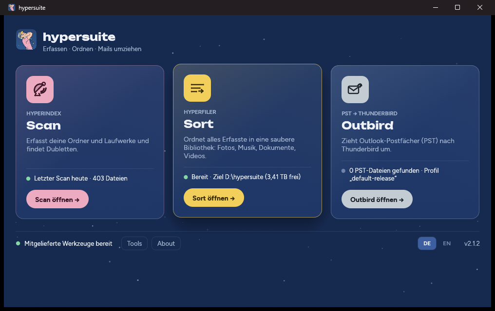

# hypersuite – Kurzanleitung

**Erfassen · Ordnen · Mails umziehen** – ein Windows-Programm, das alle
Dateien auf deinen Laufwerken erfasst, sie in eine saubere Bibliothek ordnet
und Outlook-Postfächer nach Thunderbird bringt. Alles läuft lokal; hypersuite
baut keine Netzwerkverbindungen auf.

Die Oberfläche gibt es auf Deutsch und Englisch (`DE | EN` in jedem Fenster).
Ausführlich: das [Handbuch](handbuch.md) – auch als gestaltetes [PDF](hypersuite-handbuch.pdf) – und die englische [Documentation](../README.md).

## Herunterladen und starten

1. `hypersuite.exe` aus dem [neuesten Release](https://github.com/namshubs/hypersuite/releases/latest)
   laden. Windows 10/11, 64 Bit. Keine Installation, keine Adminrechte.
2. Optional prüfen (PowerShell): `Get-FileHash .\hypersuite.exe` muss den
   Wert aus `SHA256SUMS.txt` ergeben.
3. Doppelklick. Warnt SmartScreen („Der Computer wurde durch Windows
   geschützt“): **Weitere Informationen** → **Trotzdem ausführen**. Die Exe ist
   selbstsigniert (hypersuite (github.com/namshubs/hypersuite)); wie man dem Zertifikat dauerhaft vertraut, steht
   in [Getting started](../getting-started.md#optional-trust-the-signature).
4. Beim ersten Start jeder Version werden die mitgelieferten Werkzeuge
   (≈ 260 MB) nach `%LOCALAPPDATA%\hypersuite\` entpackt.

## Scan – Dateien erfassen

Scan erfasst für jede Datei Pfad, Größe, Datum und eine Prüfsumme in einer
Datenbank. **Scan liest nur**, es verändert nichts.

- **Was scannen:** standardmäßig Dokumente, Bilder, Musik, Videos, Desktop
  (Downloads aus). **Ordner hinzufügen** für weitere; ganze Laufwerke unter
  *Advanced → Quellen*.
- **Datenbank:** automatisch `%USERPROFILE%\HyperindexDB\<Computer>-<Benutzer>-db\index.db`.
  Reicht der Platz nicht, schlägt Scan das Laufwerk mit dem meisten freien
  Platz vor. **Vorhandene öffnen…** übernimmt eine bestehende Datenbank samt
  den Einstellungen ihres letzten Scans.
- **Abgebrochen?** Scan zeigt „Der letzte Scan wurde abgebrochen“ →
  **Fortsetzen**. Schon Erfasstes wird nicht neu gelesen.
- Wiederholte Scans sind schnell: Unveränderte Dateien werden nicht neu
  gelesen. USB-Sticks werden über ihre Seriennummer wiedererkannt, auch unter
  anderem Laufwerksbuchstaben.
- *Advanced:* Berichte über doppelte Dateien und doppelte Ordner (löschen
  nichts), **Fotos anreichern** (Aufnahmedatum und Ort, offline – vor Sort
  ausführen), Beets-Vorfilter für Musik, Statistik.

## Sort – Bibliothek bauen

Sort **kopiert** alles Erfasste in eine geordnete Bibliothek, standardmäßig
`<Laufwerk mit dem meisten Platz>:\hypersuite`. Die Originale bleiben
unangetastet.

1. **Planen** – legt fest, was wohin kommt. Nichts wird kopiert.
2. **Prüfen** – zeigt den Plan und warum Dateien ins Archiv oder in die
   Dokumenten-Inbox gehen.
3. **Ausführen** – kopiert und prüft jede Kopie gegen die Prüfsumme.
   Unterbrechen ist jederzeit möglich; ein erneuter Lauf macht weiter.
4. **Kontrollieren** – prüft die ganze Bibliothek erneut.

Aufbau: `Photo\<Jahr>\<Jahr-Monat>\…`, `Music\<Interpret>\<Jahr> - <Album>\…`,
`Video\Movies|Series|Home\…`, `Docs\Tax|Administration|Business|Family|Identity|Inbox\…`,
`Archive\<Seriennummer>\<Originalpfad>` für alles, was sich nicht sicher
einordnen lässt – nichts wird geraten oder ausgelassen. Details:
[Sort](../sort.md).

*Advanced:* Spiegeln statt umsortieren, OCR für gescannte PDFs,
KI-Dokumentsortierung (lokales Modell), eigene Firmen/Personen
(`entities.toml`), Film-Genres (`genres.toml`), PST-Dateien aus dem Index
verarbeiten, Suche im Bestand, Wartung.

**Quarantäne und endgültig löschen:** Erst wenn die Bibliothek kontrolliert
und separat gesichert ist. *Quarantäne* verschiebt die Originale nur zur
Seite. *Endgültig löschen* ist der einzige Schritt, der etwas löscht – nur
Dateien, die länger als die Frist (30 Tage) in der Quarantäne liegen, nur mit
deiner Bestätigung eines Backups, und nie eine Datei, deren Kopie in der
Bibliothek nicht mehr stimmt.

## Outbird – Outlook nach Thunderbird

1. **PST-Datei** wählen – Outbird schlägt gefundene Dateien vor.
2. **Nach:** dein Thunderbird-Profil (automatisch das Standardprofil).
3. Thunderbird schließen, Häkchen setzen, **In Thunderbird übernehmen**.

Outbird sichert zuerst das ganze Profil (`outbird-backup-<Datum>` neben dem
Profil), konvertiert und prüft, und schreibt erst dann in die *Lokalen
Ordner*. Ordner, Mails, Anhänge und angehängte Mails kommen vollständig mit;
Kontakte und Kalender nicht. Alternativ unter *Advanced*: als mbox-Ordner
exportieren, ohne Thunderbird anzufassen. Details: [Outbird](../outbird.md).

## Feedback

Fehler und Wünsche bitte als [Issue](https://github.com/namshubs/hypersuite/issues/new/choose),
gern auf Deutsch. Fragen in den [Discussions](https://github.com/namshubs/hypersuite/discussions).
Sicherheitslücken bitte nicht öffentlich melden, sondern wie in
[SECURITY.md](../../SECURITY.md) beschrieben.

## Quellcode und Mitarbeit

Entwickelt wird auf einem eigenen Git-Server; hier liegen nur Releases und
Dokumentation – bewusst, damit Code und Kernideen nicht in KI-Trainingsdaten
landen und die Richtung des Projekts in der Hand des Autors bleibt. Wer den
Code ansehen oder mitarbeiten möchte, braucht vier Dinge – Mensch, keine
Verbindung zu Big Tech, Engagement für Datenschutz bzw. Nutzerrechte, eine
technische Verbesserungsagenda – und ein interaktives Onboarding; Details in
[CONTRIBUTING.md](../../.github/CONTRIBUTING.md). Anfrage per Discussion in der
Kategorie „Contributor access“ oder Issue mit der Vorlage *Contributor access*.

Lizenz: [Sustainable Use License 1.0](../../LICENSE) – kostenlos für private,
nicht-kommerzielle und interne geschäftliche Nutzung; keine Open-Source-Software.

**Nutzung auf eigene Gefahr:** Es gibt keinen geregelten Support, und wie jede
Software kann hypersuite Fehler enthalten. Bewahren Sie Ihre Originaldaten und
eine unabhängige Sicherung auf, bis Sie das Ergebnis selbst geprüft haben.
