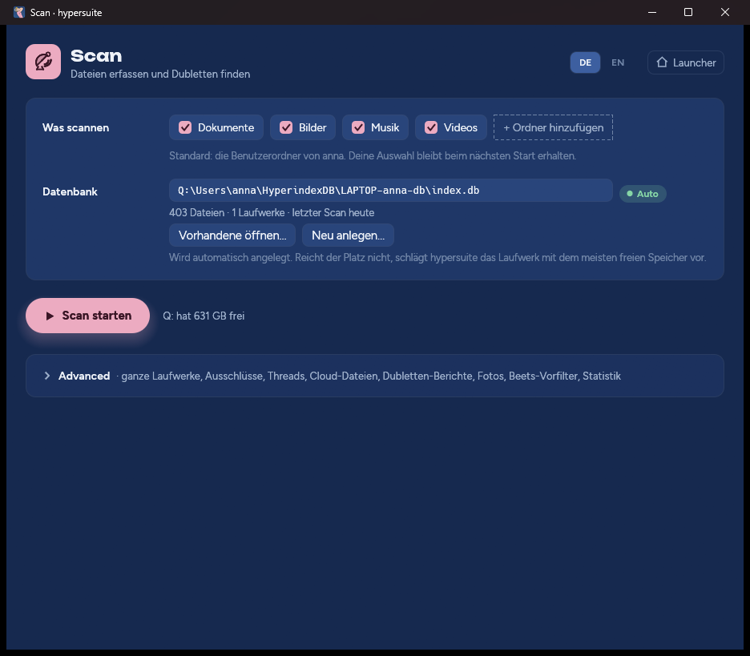
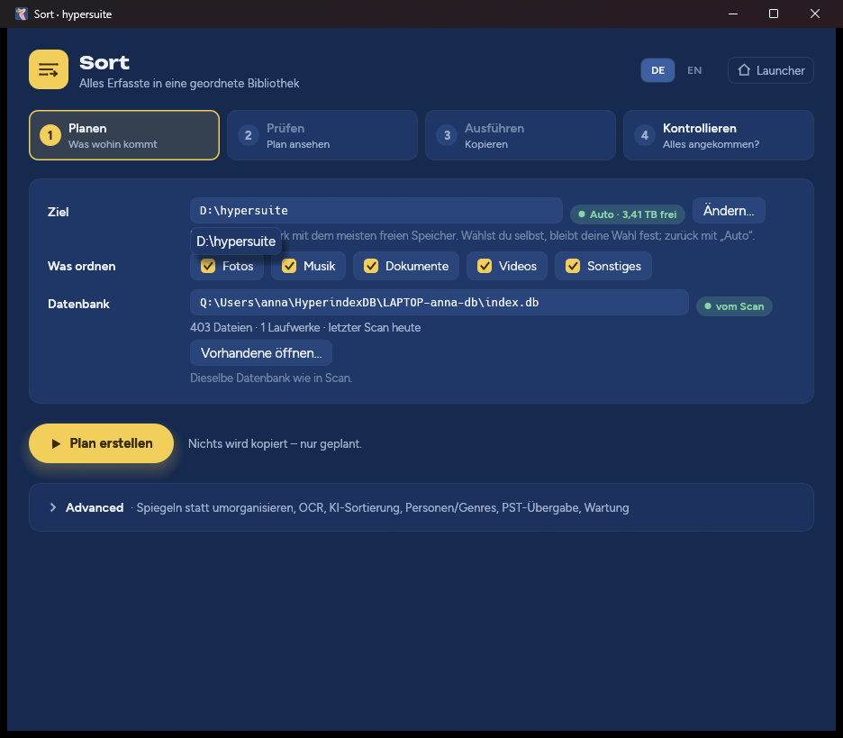
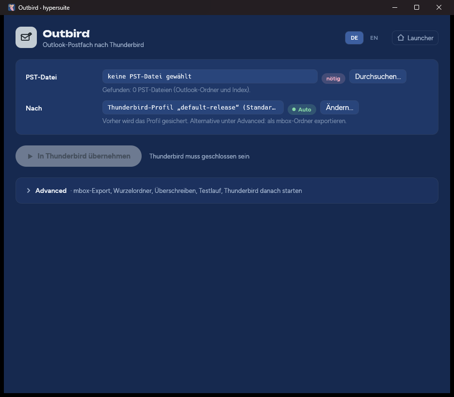

# hypersuite 2.1 – Handbuch

**Erfassen · Ordnen · Mails umziehen.** Ihre Dateien und Ihre Outlook-Mails aus
einer Windows-Umgebung – aufbereitet, geordnet und sofort wieder nutzbar.

Version 2.1.7 · Oktober 2026 · für Windows 10 und 11 (64 Bit)

<!-- pdf:part -->
## Teil I – Was hypersuite für Sie tut

Jeder Windows-Rechner sammelt über die Jahre ein eigenes kleines Universum an:
Fotos vom Handy und von drei alten Kameras, Musik von CDs und Downloads,
Rechnungen, Verträge und Steuerunterlagen, Filme, Sicherungskopien von
Sicherungskopien – verteilt auf die interne Platte, zwei USB-Festplatten, einen
Stapel Sticks und einen Cloud-Ordner. Dazu ein Outlook-Postfach mit zwanzig
Jahren Korrespondenz in einer einzigen, schwer zugänglichen PST-Datei.

**hypersuite bringt das alles in Ordnung – und auf ein Medium Ihrer Wahl.**
Das Programm erfasst jede Datei auf allen Laufwerken, findet Doppeltes, sortiert
den gesamten Bestand in eine klare, für Menschen lesbare Ordnerstruktur und
spielt sie zum Beispiel auf eine Backup-Festplatte. Das Ergebnis sind ganz
normale Windows-Ordner und -Dateien: Sie öffnen sie im Explorer, mit der
Fotoanzeige, mit Word oder dem Mediaplayer – **sofort, ohne Spezialsoftware,
ohne Import, ohne proprietäres Archivformat.**

Und Ihre Mails? Die bringt hypersuite aus Outlook nach **Thunderbird – mit der
kompletten Ordnerstruktur 1:1.** Posteingang, Gesendete Elemente und jeder
selbst angelegte Unterordner erscheinen in Thunderbird genau so, wie Sie sie in
Outlook gepflegt haben, samt allen Anhängen.

Alles in **einer einzigen Programmdatei**: keine Installation, keine
Administratorrechte, keine Cloud, kein Konto. hypersuite arbeitet vollständig
auf Ihrem Rechner und baut keine einzige Netzwerkverbindung auf.

### Wofür sich hypersuite besonders eignet

- **Umzug auf einen neuen PC** – alles Wichtige vom alten Rechner geordnet
  sichern und auf dem neuen sofort weiterverwenden.
- **Backup mit System** – statt Kopien ungeordneter Kopien eine saubere,
  dublettenfreie Bibliothek auf der Sicherungsplatte.
- **Aufräumen nach Jahren** – sehen, was wirklich doppelt ist, auf welchen
  Laufwerken, in welchen Ordnern.
- **Abschied von Outlook** – ein Postfach oder ein ganzes Archiv aus PST-Dateien
  nach Thunderbird übernehmen, ohne dass ein Ordner verloren geht.
- **Nachlass und Firmenauflösung** – die Daten eines Rechners vollständig,
  nachvollziehbar und geordnet übergeben.

<!-- pdf:module scan -->
### Scan – das Gedächtnis Ihrer Laufwerke

**Bevor man ordnet, muss man wissen, was da ist.** Scan liest jedes Laufwerk,
jeden Ordner, jede Datei und legt ein präzises Verzeichnis an: Name, Ort, Größe,
Datum – und einen digitalen Fingerabdruck des Inhalts (BLAKE3-Prüfsumme). Zwei
Dateien mit gleichem Fingerabdruck sind bitgenau identisch, egal wie sie heißen
und wo sie liegen.

**Scan vergisst nichts.** Ein USB-Stick, den Sie heute einlesen und nächsten
Monat wieder abziehen, bleibt im Verzeichnis – erkannt an seiner Seriennummer,
nicht am Laufwerksbuchstaben. So findet Scan Dubletten über alles hinweg, was Sie
je erfasst haben, auch über Datenträger, die gerade in der Schublade liegen.

**Scan ist schnell, wenn es darauf ankommt.** Beim zweiten Durchgang liest es nur
noch, was sich geändert hat. Ein unterbrochener Scan – Stromausfall, Neustart,
Fenster geschlossen – wird mit einem Klick fortgesetzt, ohne Bereits-Erfasstes
erneut zu lesen. Vorher prüft Scan, ob für sein Verzeichnis genug Platz ist, und
schlägt bei Bedarf das Laufwerk mit dem meisten freien Speicher vor.

**Scan verändert nichts.** Es liest ausschließlich. Die Berichte über doppelte
Dateien und doppelte Ordner zeigen, was sich sicher entfernen ließe – entscheiden
und löschen tun Sie selbst. Für Fotos ermittelt Scan zusätzlich das
Aufnahmedatum und – bei Bildern mit GPS-Daten – den Aufnahmeort, mit einer
eingebauten Ortsdatenbank, ohne dass je ein Standort Ihren Rechner verlässt.

<!-- pdf:module sort -->
### Sort – Ihre Bibliothek, sofort nutzbar

**Aus Chaos wird eine Bibliothek.** Sort nimmt alles, was Scan erfasst hat, und
baut daraus eine einzige, klar gegliederte Ordnerstruktur – auf der internen
Platte, einer externen Festplatte oder jedem anderen Ziel, das Sie wählen:

- **Fotos** nach Jahr und Monat, mit Aufnahmedatum und Ort im Dateinamen –
  RAW und JPEG, Live-Photos und Begleitdateien bleiben zusammen.
- **Musik** nach Interpret, Jahr und Album, Titel mit Tracknummer.
- **Videos** getrennt nach Filmen, Serien (Staffel, Folge) und eigenen Aufnahmen.
- **Dokumente** nach Steuer, Verwaltung, Geschäft, Familie und Ausweisen – mit
  dem Datum aus dem Dokument selbst, auf Wunsch mit Texterkennung für gescannte
  PDFs und mit einem lokalen KI-Modell, das von Ihren Beispielen lernt.
- **Alles Übrige** – Programme, Archive, Sonstiges – unverändert mit seinem
  ursprünglichen Pfad.

**Das Ergebnis sind gewöhnliche Ordner und Dateien.** Kein Container, kein
Datenbankformat, keine Abhängigkeit von hypersuite: Schließen Sie die
Backup-Platte an einen beliebigen Windows-Rechner an, und Ihre Fotos, Musik und
Dokumente sind sofort da – im Explorer, in der Fotos-App, in Word. Jede Datei
liegt genau einmal in der Bibliothek, auch wenn sie vorher fünfmal auf vier
Laufwerken verstreut war.

**Sicherheit in vier Schritten.** *Planen* – Sort legt fest, was wohin kommt,
ohne eine Datei anzufassen. *Prüfen* – Sie sehen den Plan, bevor etwas passiert.
*Ausführen* – Sort kopiert und vergleicht jede Kopie mit dem Fingerabdruck des
Originals. *Kontrollieren* – die gesamte Bibliothek wird erneut geprüft. Ihre
Originale bleiben dabei unberührt. Was sich nicht sicher einordnen lässt, wird
nicht geraten, sondern unverändert im Archiv abgelegt – verloren geht nichts.

Wer seine gewohnte Ordnerstruktur behalten möchte, schaltet auf **Spiegeln**:
Dann bringt Sort alle Laufwerke 1:1 mit ihren Original-Ordnern auf ein Ziel
zusammen – ideal als vollständige Sicherung eines alten Rechners.

<!-- pdf:module mail -->
### Outbird – Outlook nach Thunderbird, Ordner für Ordner

**Ihr Postfach zieht komplett um.** Outbird öffnet Outlook-Datendateien (PST)
direkt – Outlook muss dafür nicht einmal installiert sein – und überträgt sie in
Thunderbird, den freien Mail-Client von Mozilla.

**Die Ordnerstruktur bleibt 1:1 erhalten.** Das ist der entscheidende Vorteil:
Jeder Ordner, den Sie in Outlook über Jahre angelegt haben – Projekte, Kunden,
Jahre, Ablagen in Ablagen –, erscheint in Thunderbird in derselben Hierarchie,
mit denselben Namen, mit jeder einzelnen Nachricht. Kein Neu-Sortieren, kein
Suchen nach verschollenen Unterordnern.

**Vollständig bis ins Detail.** Absender, Empfänger, Datum und die originalen
Kopfzeilen jeder Mail, Text- und HTML-Inhalt, jeder Anhang bitgenau – auch Mails,
die als Anhang in anderen Mails stecken, samt deren eigenen Anhängen. Signierte
Nachrichten bleiben gültig signiert. Nach der Umwandlung zählt Outbird nach:
jeder Ordner, jede Nachricht wird mit der PST-Datei abgeglichen.

**Sicher für Ihr bestehendes Thunderbird.** Bevor Outbird etwas schreibt, prüft
es, dass Thunderbird geschlossen ist, und sichert Ihr komplettes
Thunderbird-Profil. Jede PST-Datei landet in einem eigenen Ordner unter *Lokale
Ordner* – mehrere Postfächer vermischen sich nicht. Alternativ exportiert Outbird
in einen eigenständigen mbox-Ordner, etwa direkt auf die Backup-Platte, ohne
Thunderbird überhaupt anzufassen.

### Gebaut für Vertrauen

- **Nur lesen, dann kopieren, dann prüfen.** Scan liest nur. Sort kopiert und
  verifiziert jede Kopie. Gelöscht wird ausschließlich auf Ihren ausdrücklichen
  Befehl – und nie eine Datei, deren Kopie nicht nachweislich stimmt.
- **Duplikate nach Inhalt.** Duplikat heißt: gleiche Größe und gleiche
  BLAKE3-Prüfsumme über den ganzen Inhalt – keine Stichproben, kein Vergleich
  nach Name oder Datum. Die Berichte empfehlen nur; gelöscht wird nichts.
- **Erst planen, dann kopieren.** Plan und Prüfen in Sort sind der Probelauf:
  Sie sehen, wohin jede Datei käme, bevor eine einzige kopiert wird.
- **Die PST bleibt unberührt.** Outbird öffnet die PST-Datei nur zum Lesen,
  sichert das ganze Thunderbird-Profil, bevor es etwas hineinschreibt, und
  schreibt nur, wenn die Umwandlung geprüft ist und Thunderbird geschlossen ist.
- **Offline.** Keine Telemetrie, keine Updates im Hintergrund, kein Konto.
  Sprachmodell, Texterkennung (Deutsch, Englisch, Französisch, Italienisch,
  Spanisch, Russisch), PDF-Darstellung und Musik-Fingerabdrücke sind eingebaut.
- **Unterbrechbar.** Jeder lange Vorgang lässt sich abbrechen und später genau
  dort fortsetzen.
- **Zweisprachig.** Oberfläche auf Deutsch und Englisch, umschaltbar mit einem
  Klick.
- **Eine Datei.** `hypersuite.exe` passt auf einen USB-Stick und läuft auf jedem
  Windows 10 und 11 ohne Installation.

<!-- pdf:part -->
## Teil II – Bedienungsanleitung

### 1. Voraussetzungen

| | |
|---|---|
| Betriebssystem | Windows 10 oder Windows 11, 64 Bit |
| Rechte | Normale Benutzerrechte genügen; keine Installation |
| Platz für das Programm | ca. 230 MB für `hypersuite.exe`, ca. 260 MB beim ersten Start für die mitgelieferten Werkzeuge |
| Platz für das Verzeichnis | ca. 1 GB je 1,3 Millionen erfasste Dateien – Scan prüft das vorab |
| Platz für die Bibliothek | bis zur Größe aller zu ordnenden Daten, da Sort kopiert |
| Für Outbird | Thunderbird (beim Übernehmen ins Profil); für den mbox-Export nicht nötig |

### 2. Herunterladen, prüfen, starten

1. Laden Sie aus dem neuesten Release auf
   <https://github.com/namshubs/hypersuite/releases/latest> die Datei
   `hypersuite.exe` und die Datei `SHA256SUMS.txt` herunter.
2. **Prüfen Sie den Download** (empfohlen). Öffnen Sie PowerShell im
   Download-Ordner und geben Sie ein:

   ```powershell
   Get-FileHash .\hypersuite.exe -Algorithm SHA256
   Get-Content .\SHA256SUMS.txt
   ```

   Der Wert für `hypersuite.exe` muss in beiden Ausgaben identisch sein.
   Die Release-Notes verlinken außerdem den **VirusTotal**-Bericht zu genau
   diesem SHA-256-Wert – das Urteil von rund 70 Virenscannern über genau diese
   Datei.
3. Legen Sie `hypersuite.exe` an einen beliebigen Ort – Downloads, ein
   Werkzeugordner oder ein USB-Stick.
4. **Doppelklick.** Beim ersten Mal zeigt Windows möglicherweise *„Der Computer
   wurde durch Windows geschützt“*. Klicken Sie auf **Weitere Informationen** und
   dann auf **Trotzdem ausführen**. Die Datei ist digital signiert (Herausgeber
   *hypersuite (github.com/namshubs/hypersuite)*); weil das Zertifikat selbst ausgestellt ist, kennt Windows es
   anfangs nicht.
5. Beim ersten Start jeder Version entpackt hypersuite für einige Sekunden seine
   Werkzeuge. Unten links erscheint dann **Mitgelieferte Werkzeuge bereit**.

> **Dem Zertifikat dauerhaft vertrauen (optional).** Laden Sie zusätzlich
> `hypersuite-codesign.cer` herunter und führen Sie in einer
> Administrator-Eingabeaufforderung aus:
> `certutil -addstore Root hypersuite-codesign.cer` und
> `certutil -addstore TrustedPublisher hypersuite-codesign.cer`.
> Danach zeigt Windows *hypersuite (github.com/namshubs/hypersuite)* als bestätigten Herausgeber.

### 3. Der Launcher


Der Launcher ist die Startseite. Jede der drei Karten öffnet ein Modul in einem
eigenen Fenster:

- **Scan** – zeigt, wann zuletzt gescannt wurde und wie viele Dateien erfasst sind.
- **Sort** – zeigt das Ziel der Bibliothek und den freien Platz dort.
- **Outbird** – zeigt, wie viele PST-Dateien gefunden wurden und welches
  Thunderbird-Profil verwendet wird.

Scan und Sort können gleichzeitig geöffnet sein. Ein Klick auf die Karte eines
bereits offenen Moduls holt dessen Fenster in den Vordergrund. In der Fußzeile
finden Sie **Tools** (Zustand der mitgelieferten Werkzeuge), **About** (Version,
Lizenz, Drittsoftware) und den Sprachumschalter **DE | EN**.

#### Auto und Manuell

Viele Einstellungen tragen ein Kennzeichen: **● Auto** bedeutet, dass hypersuite
den Wert selbst ermittelt – bei jedem Start neu. Sobald Sie ihn ändern, wird er
**Manuell** und bleibt so. Ein Klick auf das Kennzeichen *Manuell* kehrt zum
automatischen Wert zurück. Unter **Advanced** finden Sie in jedem Modul alle
weiteren Optionen; **… auf Standard zurücksetzen** stellt dort alles wieder auf
Auto.

### 4. Schritt für Schritt: vom alten PC auf die Backup-Platte

Dieses Kapitel beschreibt den typischen Einsatz: Alle Dateien und das
Outlook-Postfach eines Windows-Rechners geordnet auf eine externe Festplatte
bringen, sodass alles sofort weiter nutzbar ist.

1. **Backup-Platte anschließen.** Eine leere oder ausreichend große externe
   Festplatte, z. B. Laufwerk `E:`.
2. **Scan öffnen.** Wählen Sie, was erfasst werden soll: Die Benutzerordner
   (Dokumente, Bilder, Musik, Videos, Desktop) sind vorausgewählt. Für den
   ganzen Rechner öffnen Sie **Advanced → Quellen → Alle lokalen Laufwerke**.
   Weitere Datenträger (alte USB-Platten, Sticks) anschließen und mitscannen.
3. **Scan starten.** Scan zählt zunächst die Dateien, prüft den Platz und
   erfasst dann alles. Bei großen Beständen kann das Stunden dauern – Sie können
   jederzeit abbrechen und später **Fortsetzen**.
4. **Fotos anreichern.** In Scan unter **Advanced → Fotos → Fotos anreichern**.
   Damit werden Fotos nach ihrem echten Aufnahmedatum einsortiert.
5. **Optional: Dubletten ansehen.** **Advanced → Dubletten und Berichte →
   Bericht: doppelte Ordner** zeigt, was mehrfach vorhanden ist. Für die
   Bibliothek ist das nicht nötig – Sort übernimmt jede Datei ohnehin nur einmal.
6. **Sort öffnen und das Ziel wählen.** Unter **Ziel** auf **Ändern…** klicken und
   einen Ordner auf der Backup-Platte wählen, z. B. `E:\hypersuite`.
7. **Planen, Prüfen, Ausführen, Kontrollieren** – die vier Schritte oben im
   Fenster, nacheinander. Vor dem Ausführen fragt Sort noch einmal nach.
8. **Outbird öffnen** und die Outlook-Datei übernehmen (siehe Kapitel 7):
   entweder direkt in Thunderbird oder – für die Backup-Platte – unter
   **Advanced → Ziel → mbox-Ordner** als Export nach `E:\hypersuite\mboxemails\`.
9. **Fertig.** Auf der Backup-Platte liegt jetzt eine vollständige, geordnete
   Kopie. Öffnen Sie sie im Explorer – alles ist sofort benutzbar.

> **Die Originale bleiben, wo sie sind.** Erst wenn die Bibliothek kontrolliert
> und zusätzlich gesichert ist, können Sie die Originale über *Quarantäne* und
> *Endgültig löschen* aufräumen (Kapitel 6.6). Das ist optional.

### 5. Scan im Detail



#### 5.1 Was scannen

Die Schaltflächen **Dokumente, Bilder, Musik, Videos, Desktop** stehen für Ihre
Windows-Benutzerordner und sind vorausgewählt; **Downloads** ist aus. Ein Klick
schaltet einen Ordner ein oder aus. **Ordner hinzufügen** nimmt beliebige weitere
Ordner auf. Ihre Auswahl wird gespeichert.

#### 5.2 Die Datenbank

Das Verzeichnis aller Dateien ist eine Datenbankdatei. hypersuite legt sie
automatisch an: `%USERPROFILE%\HyperindexDB\<Computer>-<Benutzer>-db\index.db`.
Scan und Sort verwenden dieselbe Datenbank.

- Unter dem Pfad steht, wie viele Dateien und Laufwerke sie enthält und wann
  zuletzt gescannt wurde.
- **Vorhandene öffnen…** verwendet eine bestehende Datenbank – etwa von einem
  früheren Lauf – und übernimmt die Ordner und Optionen ihres letzten Scans.
- **Neu anlegen…** erstellt eine neue Datenbank in einem Ordner Ihrer Wahl.
- **Zuletzt benutzt…** listet die letzten fünf Datenbanken.
- Ist eine gewählte Datei keine gültige Datenbank, erscheint sie rot, und
  **Scan starten** bleibt gesperrt.
- Reicht der Platz auf dem Laufwerk der Datenbank nicht, schlägt ein Dialog das
  Laufwerk mit dem meisten freien Speicher vor (oder **Anderer Ordner…**).

#### 5.3 Scan starten und fortsetzen

**Scan starten** zählt zuerst die Dateien (**Ohne Zählen starten** überspringt
das) und zeigt dann einen Fortschrittsbalken mit Restzeit. **Details anzeigen**
öffnet das vollständige Protokoll.

Wurde ein Scan unterbrochen, erscheint beim nächsten Öffnen die Karte **Der
letzte Scan wurde abgebrochen** mit den noch offenen Laufwerken. **Fortsetzen**
macht genau dort weiter.

Wiederholte Scans sind schnell: Unveränderte Dateien werden nicht erneut gelesen.
Regelmäßig neu zu scannen ist der vorgesehene Weg, das Verzeichnis aktuell zu
halten.

#### 5.4 Advanced

| Bereich | Option | Bedeutung |
|---|---|---|
| Quellen | Alle lokalen Laufwerke | Alle Laufwerke statt der Ordnerauswahl |
| | auch Netzlaufwerke | zusätzlich verbundene Netzlaufwerke |
| | Verknüpfungen/Junctions folgen | standardmäßig aus, um Schleifen zu vermeiden |
| | Alles neu hashen | jede Datei neu prüfen – erkennt schleichende Datenfehler |
| | Nur-online-Dateien (OneDrive) | **überspringen**: nur Name, Größe, Datum erfassen, nichts herunterladen; **herunterladen und hashen**: vollständig lesen |
| | Ordner ausschließen | Ordnernamen, die überall übersprungen werden, z. B. `node_modules, .git` |
| | Threads | Anzahl paralleler Leseprozesse; leer = automatisch |
| Dubletten und Berichte | Berichtsordner | Standard `Dokumente\hypersuite` |
| | Dateien ignorieren unter (Bytes) | Standard 4096 Byte |
| | Bericht: doppelte Dateien | jede Gruppe identischer Dateien, mit Empfehlung, welche bleibt |
| | Bericht: doppelte Ordner | Ordner, deren Inhalt vollständig anderswo vorhanden ist |
| Fotos | Fotos anreichern | Aufnahmedatum und Ort ermitteln (offline) |
| | Foto-Bibliothek planen / anwenden / rückgängig | eigene, reine Foto-Bibliothek; für alles andere Sort verwenden |
| Musik | Beets-Vorfilter | bereitet Musik für das Programm *beets* vor |
| Einblick | Volumes, Statistik, Aktionsprotokoll | was das Verzeichnis enthält und was geplant wurde |

Die Berichte werden als Markdown-Datei und als JSON-Datei gespeichert und löschen
nichts.

### 6. Sort im Detail



#### 6.1 Ziel und Klassen

**Ziel** ist der Ordner der Bibliothek. Automatisch wählt Sort einen Ordner
`hypersuite` auf dem lokalen Laufwerk mit dem meisten freien Platz. Für eine
Backup-Platte wählen Sie mit **Ändern…** einen Ordner darauf. Liegt das Ziel auf
einem Laufwerk, das Sie auch gescannt haben, weist Sort darauf hin – das
funktioniert, ein separates Laufwerk ist aber sicherer.

**Was ordnen:** Fotos, Musik, Dokumente, Videos und Sonstiges – alle
vorausgewählt.

#### 6.2 Die vier Schritte

| Schritt | Schaltfläche | Was passiert |
|---|---|---|
| 1 Planen | **Plan erstellen** | Sort legt für jede Datei fest, wohin sie kommt. Nichts wird kopiert. Der Plan erhält eine Nummer und einen Bericht im Ordner `.hyperfiler\plans` des Ziels. |
| 2 Prüfen | **Plan prüfen** | Übersicht: wie viele Dateien wohin gehen und warum Dateien im Archiv oder in der Dokumenten-Inbox landen. Bericht als Markdown oder JSON öffnen. |
| 3 Ausführen | **Ausführen…** | Nach Rückfrage: Kopieren, jede Kopie gegen den Fingerabdruck prüfen, als erledigt markieren. |
| 4 Kontrollieren | **Kontrollieren** | Liest jede Datei der Bibliothek erneut und vergleicht sie. Ändert nichts. |

*Ausführen* lässt sich jederzeit unterbrechen; ein erneuter Start macht weiter,
fertige Kopien werden erkannt. Hat sich eine Quelldatei seit dem Planen
geändert, schlägt sie fehl, statt falsch kopiert zu werden – planen Sie dann neu.

#### 6.3 Aufbau der Bibliothek

```
E:\hypersuite\
├── Photo\2024\2024-07\20240714_Lugano_IMG_0412.jpg
├── Music\Queen\1975 - A Night at the Opera\11 - Bohemian Rhapsody.mp3
├── Video\
│   ├── Movies\Inception (2010)\Inception (2010) - 1080p.mkv
│   ├── Series\Dark (2017)\Season 01\Dark - S01E01 - Secrets.mkv
│   └── Home\2023\2023-12\20231224_Familie.mp4
├── Docs\
│   ├── Tax\2023\Steuererklärung - Finanzamt - 2024-05-02.pdf
│   ├── Administration\2024\Invoice\Stadtwerke - Invoice - 2024-03-01.pdf
│   ├── Business\Clients\<Kunde>\2024\…
│   ├── Family\2022\…
│   ├── Identity\Passport_Anna.pdf
│   └── Inbox\2024-03\Scan_017__a1b2c3d4.pdf
├── Archive\<Laufwerks-Seriennummer>\<Originalpfad>
└── .hyperfiler\   (Pläne, Quarantäne)
```

- **Fotos** werden nach Aufnahmedatum abgelegt (vorher *Fotos anreichern*); der
  Ort stammt aus GPS-Daten. RAW- und JPEG-Paare, XMP-Dateien und
  Live-Photo-Videos bleiben zusammen.
- **Musik** wird nach ihren Tags abgelegt; fehlen sie, übernimmt Sort sie von
  einer akustisch identischen Kopie, die sie hat.
- **Videos** werden am Dateinamen erkannt (`Titel (2019) 1080p`, `Serie S01E02`),
  dann an eingebetteten Daten und `.nfo`-Dateien. Alles andere gilt als eigene
  Aufnahme.
- **Dokumente** (PDF, Word `.docx`/`.doc`, OpenDocument `.odt`, Text) werden
  gelesen und nach festen Regeln eingeordnet. Was nicht sicher zuzuordnen ist,
  landet in `Docs\Inbox` – es wird nichts geraten.
- **Sonstiges** wird unverändert übernommen.
- **Archive** ist das Sicherheitsnetz: Dateien ohne verwertbare Angaben werden
  bitgenau mit ihrem Originalpfad unter der Seriennummer ihres Laufwerks
  abgelegt.

Gleichnamige, aber verschiedene Dateien bleiben beide erhalten (`-v1`, `-v2`
nach Datum bzw. mit der Laufwerks-Seriennummer). Identische Dateien landen genau
einmal in der Bibliothek.

#### 6.4 Advanced: Modus und Dokumente

- **Umorganisieren (Bibliotheks-Struktur)** – der Aufbau oben (Standard).
- **Spiegeln (Quellstruktur 1:1)** – keine Sortierung: Alles wird mit seiner
  originalen Ordnerstruktur nach `Archive\<Seriennummer>\…` kopiert. Ideal, um
  mehrere Laufwerke unverändert auf einer Backup-Platte zusammenzuführen.
- **entities.toml** – Ihre eigenen Firmen, Kunden und Personen, damit Dokumente
  unter deren Namen abgelegt werden:

  ```toml
  [[entity]]
  name = "Stadtwerke München"
  aliases = ["SWM"]
  role = "vendor"          # vendor (Absender), client (Kunde), holder (Inhaber)
  class = "administration" # tax, administration, business, family, identity

  [[entity]]
  name = "Anna Beispiel"
  role = "holder"          # wessen Pass, Ausweis oder Urkunde
  ```

- **OCR-Seiten** – gescannte PDFs bis zu dieser Seitenzahl per Texterkennung
  lesen (leer = aus; einige Sekunden pro Seite).
- **KI-Dokumentsortierung** – ein mitgeliefertes, mehrsprachiges Sprachmodell
  ordnet Dokumente ein, die sonst in die Inbox gingen. Es lernt aus Beispielen,
  die Sie mit `hypersuite file inbox-review` vergeben, und läuft vollständig
  offline.
- **genres.toml** – Ihre Zuordnung von Filmtiteln zu Genres:

  ```toml
  [movies]
  "The Matrix" = "Sci-Fi"
  "Der Pate" = "Drama"
  ```

#### 6.5 PST-Dateien im Index

Outlook-Dateien, die Scan auf Ihren Laufwerken gefunden hat, kann Sort in einem
Zug verarbeiten: **Im Index suchen**, dann **Ignorieren** (werden wie andere
Dateien archiviert), **Als mbox ins Ziel** (nach `<Ziel>\mboxemails\<Name>`) oder
**In ein Thunderbird-Profil**, und schließlich **Gefundene Mails verarbeiten**.

#### 6.6 Wartung: Quarantäne, endgültig löschen, suchen

Wenn die Bibliothek kontrolliert **und separat gesichert** ist, können die
Originale weichen – bewusst in zwei Schritten:

1. **Quarantäne** verschiebt die Originale aller geprüften Kopien nach
   `<Ziel>\.hyperfiler\quarantine\…`. Nichts wird gelöscht. Vor jedem
   Verschieben wird die Kopie in der Bibliothek noch einmal geprüft.
2. **Endgültig löschen** entfernt Dateien, die länger als die eingestellte Frist
   (Standard 30 Tage) in der Quarantäne liegen. Es ist der **einzige** Schritt in
   hypersuite, der etwas löscht. Er verlangt unter *Backup bestätigt* eine Notiz
   von Ihnen (z. B. „NAS-Sicherung 25.10.2026“) und löscht nie eine Datei, deren
   Kopie in der Bibliothek nicht mehr stimmt. Es gibt kein Rückgängig.

**Suchen** findet Dokumente nach ihrer Bedeutung statt nach exakten Wörtern –
„Kfz-Versicherung Verlängerung“ findet auch das Schreiben, in dem diese Wörter
nicht vorkommen, sprachübergreifend. Vor der ersten Suche einmal **Suchindex neu
aufbauen**.

### 7. Outbird im Detail



#### 7.1 Die PST-Datei

Outbird schlägt PST-Dateien vor, die es in den üblichen Outlook-Ordnern
(`Dokumente\Outlook-Dateien`, `%LOCALAPPDATA%\Microsoft\Outlook`) und unter den
gescannten Dateien findet. Mit **Durchsuchen…** wählen Sie jede andere. Nach der
Auswahl zeigt Outbird, wie viele Ordner und Nachrichten die Datei enthält.

> **Exchange, Microsoft 365, IMAP:** Diese Konten speichert Outlook nicht als
> PST, sondern als Zwischenspeicher (OST). Exportieren Sie das Postfach zuerst in
> Outlook: *Datei → Öffnen und exportieren → Importieren/Exportieren → In Datei
> exportieren → Outlook-Datendatei (.pst)*.

#### 7.2 In Thunderbird übernehmen

1. Unter **Nach** steht Ihr Thunderbird-Profil; automatisch das
   Standardprofil, mit **Ändern…** ein anderes.
2. **Thunderbird schließen.** Outbird prüft das.
3. Häkchen bei *Mir ist klar, dass das mein Thunderbird-Profil verändert*
   setzen, **In Thunderbird übernehmen** klicken und bestätigen.

Outbird sichert dann das ganze Profil (`outbird-backup-<Datum>` neben dem
Profilordner), wandelt die PST-Datei in einen Ordner `<Name>-thunderbird` neben
der PST-Datei um, prüft das Ergebnis Ordner für Ordner und Nachricht für
Nachricht und kopiert erst dann alles in die **Lokalen Ordner** des Profils.
Schlägt die Prüfung fehl, bleibt das Profil unberührt. Danach startet
Thunderbird – Ihre Outlook-Ordner erscheinen dort in derselben Struktur, in
einem Ordner mit dem Namen der PST-Datei.

#### 7.3 Als mbox-Ordner exportieren

**Advanced → Ziel → mbox-Ordner** schreibt einen eigenständigen Ordner mit
Thunderbird-kompatiblen mbox-Dateien – ohne eine Thunderbird-Installation
anzufassen. Ideal für die Backup-Platte. Standardort:
`<Sort-Ziel>\mboxemails\<Name der PST>`. Später lässt sich dieser Ordner in die
*Lokalen Ordner* eines Thunderbird-Profils kopieren.

#### 7.4 Advanced

| Option | Bedeutung |
|---|---|
| Alles in einen Wurzelordner | Standard ein; leer = Name der PST-Datei. Bei mehreren PST-Dateien eingeschaltet lassen, damit sich deren Posteingänge nicht vermischen. |
| Vorhandene Postfächer/Ordner überschreiben | Standard aus: Outbird bricht ab, statt zu überschreiben. |
| Testlauf | alles außer Schreiben |
| Thunderbird danach starten | Standard ein |
| Inhalt prüfen | Ordner und Nachrichtenzahlen lesen, nichts schreiben |

Outbird überträgt **E-Mails**. Kontakte und Kalendereinträge werden nicht in
Adressbuch oder Kalender von Thunderbird übernommen.

### 8. Kommandozeile (Kurzreferenz)

Alles, was die Fenster tun, steht auch auf der Kommandozeile zur Verfügung. In
der Eingabeaufforderung `start /wait` voranstellen, in PowerShell
`| Out-Host` anhängen.

```bat
start /wait hypersuite index scan E:\ --db D:\index.db
start /wait hypersuite index scan --resume
start /wait hypersuite file plan E:\hypersuite --db D:\index.db
start /wait hypersuite file apply <PLAN-NUMMER> E:\hypersuite --db D:\index.db
start /wait hypersuite mail export C:\mail\archiv.pst --root-name ""
start /wait hypersuite tools --verify
```

`hypersuite <befehl> --help` zeigt die vollständige Hilfe mit Beispielen. Die
ausführliche Referenz (englisch):
<https://github.com/namshubs/hypersuite/blob/main/docs/command-line.md>.

### 9. Dateien, Einstellungen, Datenschutz

| Was | Wo |
|---|---|
| Einstellungen | `%LOCALAPPDATA%\hypersuite\settings.json` |
| Mitgelieferte Werkzeuge | `%LOCALAPPDATA%\hypersuite\runtime\` (ältere Versionen werden entfernt) |
| Datenbank | `%USERPROFILE%\HyperindexDB\<Computer>-<Benutzer>-db\index.db` |
| Berichte von Scan | `Dokumente\hypersuite\` |
| Bibliothek | `<Laufwerk>:\hypersuite\` oder Ihr gewähltes Ziel |
| Quarantäne | `<Ziel>\.hyperfiler\quarantine\` |
| Thunderbird-Sicherung | `%APPDATA%\Thunderbird\Profiles\outbird-backup-<Datum>\` |

hypersuite schreibt nichts in die Registry oder nach *Programme*. Die Datenbank
enthält Namen und Orte Ihrer Dateien, aber keine Inhalte – behandeln Sie sie wie
ein Inhaltsverzeichnis Ihrer Laufwerke.

**Deinstallieren:** `hypersuite.exe` löschen, `%LOCALAPPDATA%\hypersuite\`
löschen und bei Bedarf Datenbank, Berichte und Bibliothek.

### 10. Hilfe bei Problemen

| Problem | Lösung |
|---|---|
| SmartScreen-Warnung | **Weitere Informationen → Trotzdem ausführen**, oder Zertifikat vertrauen (Kapitel 2) |
| „Werkzeuge fehlen – siehe Tools“ | **Tools → Neu entpacken**; ca. 260 MB frei in `%LOCALAPPDATA%` nötig |
| In der Eingabeaufforderung erscheint nichts | `start /wait hypersuite …` verwenden |
| Scan hängt an einer Datei | meist eine Cloud-Datei oder ein langsames Laufwerk; Ordner ausschließen oder *Nur-online-Dateien: überspringen*; Abbrechen und **Fortsetzen** verliert nichts |
| „Keine hyperindex-Datenbank“ | richtige Datei mit **Vorhandene öffnen…** wählen oder **Neu anlegen…** |
| Sort meldet „Erst scannen“ | zuerst Scan ausführen oder vorhandenen Index wählen |
| Viele Dokumente in `Docs\Inbox` | `entities.toml` pflegen, OCR einschalten, KI-Sortierung mit eigenen Beispielen |
| Dateien im `Archive` statt bei Fotos/Musik | vor dem Planen *Fotos anreichern*; Cloud-Dateien mit *herunterladen und hashen* scannen |
| „Thunderbird läuft“ | Thunderbird vollständig beenden (auch im Infobereich) |
| „… existiert bereits im Thunderbird-Profil“ | *Alles in einen Wurzelordner* eingeschaltet lassen oder anders benennen |
| Kein Thunderbird-Profil gefunden | Thunderbird installieren und einmal starten – oder als mbox exportieren |

Fehler melden und Fragen stellen: <https://github.com/namshubs/hypersuite/issues>
– gern auf Deutsch, mit der Version (`hypersuite --version`) und dem Text unter
**Details anzeigen**.

### 11. Lizenz

hypersuite steht unter der **Sustainable Use License 1.0**: kostenlos nutzbar für
private, nicht-kommerzielle und interne geschäftliche Zwecke und kostenlos
weitergebbar für nicht-kommerzielle Zwecke; hypersuite zu verkaufen oder anderen
kommerziell anzubieten ist nicht erlaubt. Keine Gewährleistung (Datei `LICENSE`,
Copyright-Hinweis in `NOTICE`). hypersuite ist **keine Open-Source-Software**; der
Quellcode ist auf Anfrage einsehbar (siehe *Quellcode und Mitarbeit*). Version
2.1.3 erschien unter der Apache License 2.0; seit 2.1.4 gilt die neue Lizenz aus
den dort genannten Gründen – eine Kopie von 2.1.3, die Sie schon haben, bleibt
unter Apache 2.0. Die mitgelieferten Komponenten von
Drittanbietern behalten ihre eigenen Lizenzen; die Liste steht im Programm unter
**About**, der Quellcode der GPL/LGPL-Komponenten liegt jedem Release als
`third-party-sources.zip` bei.

#### Nutzung auf eigene Gefahr

Die Nutzung von hypersuite erfolgt auf eigene Gefahr. Es gibt keinen geregelten
Support. Wie jede Software kann hypersuite Fehler enthalten – bewahren Sie Ihre
Originaldaten und eine unabhängige Sicherung auf, bis Sie das Ergebnis selbst
geprüft haben.

Oder, wie es der Legende nach – vermutlich vom Vater von Bill Gates, dem
Juristen – hinten auf die ersten Z-80-Emulationskarten geschrieben wurde:

> „In juristischem Sinne: Wir bestreiten, dass diese Software für einen wie auch
> immer gearteten Zweck geeignet ist.“

#### Quellcode und Mitarbeit

Entwickelt wird auf einem eigenen, unabhängigen Git-Server; veröffentlicht werden
nur die Releases und die Dokumentation. Das ist bewusst so: Der Code und seine
Kernideen sollen nicht in den Trainingsdaten großer KI-Modelle landen, und die
Richtung des Projekts bleibt in der Hand des Autors.

Rückmeldungen, Fehlerberichte und Ideen sind immer willkommen. Zugang zum
Quellcode bekommt, wer das Ziel des Projekts teilt – Menschen helfen, Outlook zu
verlassen, Windows aufzuräumen und den Umstieg auf Linux vorzubereiten – und vier
Dinge mitbringt: Mensch (keine KI als Contributor; KI als Werkzeug ist in Ordnung),
keine Verbindung zu Big Tech, Engagement für Datenschutz bzw. Nutzerrechte und
eine technische Verbesserungsagenda. Die Anfrage läuft über eine Discussion in der
Kategorie „Contributor access“ oder ein Issue mit der Vorlage *Contributor
access*; danach folgen ein interaktives Onboarding und die Unterschrift unter das
Contributor Agreement. Details: `CONTRIBUTING.md` und `CONTRIBUTOR-AGREEMENT.md`
im Ordner `.github` des Projekts.

Projekt: <https://github.com/namshubs/hypersuite>
