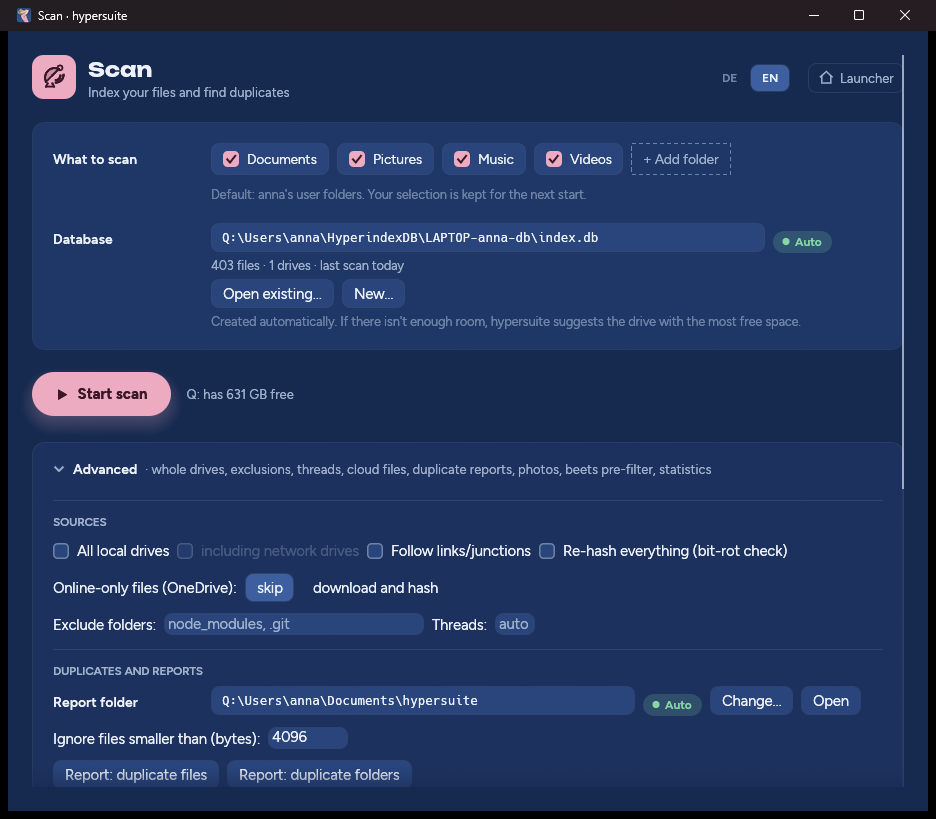

# Scan

Scan builds the **index**: one SQLite database that records, for every file
in the folders or drives you choose, its path, size, timestamps and a BLAKE3
checksum of its content. Everything else — duplicate reports, the photo
library, Sort — works from that index.

Scan **only reads**. It never moves, renames or deletes a file.

## What to scan

By default Scan offers your user folders — **Documents, Pictures, Music,
Videos, Desktop** — with **Downloads** off. Click a chip to switch it on or
off; **+ Add folder** adds any other folder. Your selection is kept for the
next start.

To scan whole drives instead, open **Advanced → Sources → All local drives**.

## The database

The database is chosen for you: `%USERPROFILE%\HyperindexDB\<COMPUTER>-<user>-db\index.db`.
Scan and Sort share it.

- Before a scan starts, Scan counts the files it will index (no reading, just
  listing; **Start without counting** skips this) and estimates the database
  size — about 736 bytes per file, plus room to grow. If the database's drive
  doesn't have enough room, a dialog proposes the fixed drive with the most
  free space, or **Other folder…**.
- **Open existing…** uses a database you already have. The line under the
  path shows how many files and drives it holds and when it was last
  scanned. Opening it also takes over the folders and options its last scan
  ran with.
- **New…** creates a database in a folder you pick
  (`HyperindexDB\<COMPUTER>-<user>-db\index.db` inside it).
- **Recently used…** lists the last five databases.
- A file that is not a hypersuite/hyperindex database is shown in red, and
  **Start scan** stays disabled.

### About Auto and Manual

Many settings in hypersuite show a chip: **● Auto** means hypersuite works the
value out by itself, again at every start. As soon as you change it, it turns
**Manual** and stays as you set it. Click the Manual chip to go back to Auto.

## Running a scan

Click **Start scan**. The progress bar and remaining time are worked out from
the file count; **Show details** shows the full log.

Repeat scans are fast: a file whose size and modification time haven't
changed keeps its stored checksum and is not read again. Scanning the same
folders every few weeks is the intended way to keep the index current.

Drives are recognised by their volume serial number, not their letter. A USB
stick scanned today as `E:` and next month as `F:` is the same volume, and
its files stay in the index while it's unplugged — so duplicates are found
across everything you have ever scanned.

### An interrupted scan

If a scan was stopped — window closed, computer restarted, power cut — Scan
shows **The last scan was interrupted** with what is left to do. **Continue**
picks up exactly there with the same folders and options; files already
indexed are not read again. Or just scan the current selection instead.

Scans made with very old versions (before hyperindex 0.93) can't be
continued; scan again — already indexed files are reused.

## Advanced

### Sources

| Option | Meaning |
|---|---|
| All local drives | Scan every fixed and removable drive instead of the folder selection. |
| including network drives | With *All local drives*: also mapped network drives. |
| Follow links/junctions | Off by default, to avoid loops through self-referencing junctions. |
| Online-only files (OneDrive) | **skip** (default): files that exist only in the cloud are recorded by name, size and date but never opened, so nothing is downloaded and the sync client can't stall the scan. **download and hash**: read them like normal files — complete checksums, at the cost of downloading everything. |
| Exclude folders | Folder names to skip everywhere, e.g. `node_modules, .git`. Windows' own folders (`$RECYCLE.BIN`, `System Volume Information`, …) and locked system files (`pagefile.sys`, …) are always skipped. |
| Threads | Hashing threads; blank = one per logical CPU. Fewer threads help on slow disks and NAS. |
| Re-hash everything | Read and checksum every file again, ignoring the stored values — a check for silent corruption (bit rot). |
| Ignore files smaller than (bytes) | For the duplicate reports: tiny files (default below 4096 bytes) produce lots of meaningless "duplicates". |

### Duplicates and reports

Reports are written to the **report folder** (default `Documents\hypersuite`)
as Markdown plus a JSON twin with the same data.

- **Report: duplicate files** — every group of files with identical content,
  across all scanned drives, with the copy it recommends keeping.
- **Report: duplicate folders** — the same at folder level, which is where
  cleaning up actually happens: folders whose files all exist elsewhere are
  marked as removable as a whole; folders that also hold one-of-a-kind files
  never are.

Nothing is deleted by either report.

### Photos

- **Enrich photos** reads each photo's capture date (EXIF, else a date in the
  file or folder name, else the file date as a last resort) and, if the photo
  has GPS data, the nearest place name from a built-in offline city database
  — no location ever leaves your computer. Results are cached; a re-run only
  looks at new photos. **Re-derive everything** redoes all of them. Run it
  before Sort, which uses these dates and places.
- **Plan photo library / Apply plan / Undo** is a separate, photo-only
  library of its own (`library/photos/<year>/<place>/<date>_<name>`, photos
  without a confident date go to `quarantine/` for you to sort by hand).
  It predates Sort; for a complete library use [Sort](sort.md) instead.
  Apply copies (never moves) and verifies every copy; **Undo** removes
  exactly the files one apply job created — tick *really delete*, otherwise
  it only lists them.

### Music

**Beets pre-filter** prepares a music collection for
[beets](https://beets.io): it collapses identical copies of the same track
(the same file on several backup drives) to one, and writes a keep-list to
feed to `beet import`. It doesn't move or tag anything.

### Look inside

- **Volumes** — every drive the index has ever seen, with file counts and size.
- **Statistics** — totals, recent scans and any interrupted scan.
- **Action log** — the plans Sort and the photo library have recorded and
  where each action stands; with a run id, the single actions of that run.

**Reset scan settings to defaults** puts every Scan option back to Auto.

## Command line

Everything here is also available as `hypersuite index …` — see
[Command line](command-line.md#hypersuite-index--scan-and-reports).
