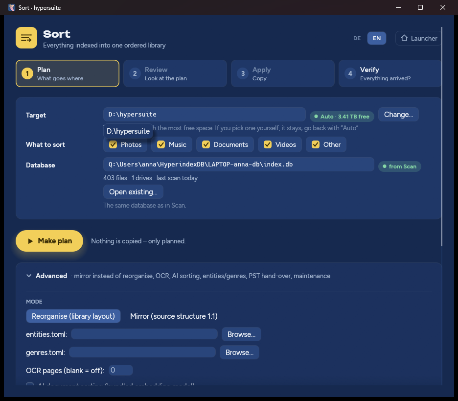

# Sort

Sort takes everything [Scan](scan.md) has indexed and builds **one ordered
library** from it — on one drive, in one predictable layout, without
duplicates. It **copies**: your original files stay exactly where they are
until you decide otherwise (see [Quarantine and purge](#quarantine-and-purge)).


Sort reads the same database as Scan. If there is none yet, it offers to open
Scan or to pick an existing index.

## Target and classes

- **Target** — where the library goes. Auto: a folder `hypersuite` on the
  fixed drive with the most free space (`D:\hypersuite`, for example). If the
  target is on a drive you scanned, Sort points that out; that works, but a
  separate drive is safer.
- **What to sort** — Photos, Music, Documents, Videos and Other, all on by
  default.

## The four steps

| Step | Button | What happens |
|---|---|---|
| 1. Plan | **Make plan** | Decides for every indexed file where it would go. Nothing is copied. The plan gets a number (`hyperfiler-plan-<date>-<time>`) and a report in the target's `.hyperfiler\plans\` folder. |
| 2. Review | **Review plan** | Shows how many files go where, and why files went to the Archive or the document Inbox. **Report (Markdown)** and **Report (JSON)** open the full plan. |
| 3. Apply | **Apply…** | After a confirmation, copies every planned file to the target, checks each copy against the checksum in the index, and only then marks it done. |
| 4. Verify | **Verify** | Re-reads every copied file in the library and compares it with its checksum. Changes nothing; reports anything missing or damaged. |

Apply is safe to interrupt. Run it again with the same plan and it continues
where it stopped; finished copies are recognised and not copied again. A
source file that changed after planning fails instead of being copied
silently — plan again to pick up the change.

You can scan more drives later and plan again: what is already in the library
is recognised.

## The library

```
<target>\
├── Photo\<YYYY>\<YYYY-MM>\<YYYYMMDD>_<place>_<original name>.<ext>
├── Music\<Album artist>\<YYYY> - <Album>\<NN> - <Title>.<ext>
├── Video\
│   ├── Movies\<Title> (<YYYY>)\<Title> (<YYYY>) - <quality>.<ext>
│   ├── Series\<Title> (<YYYY>)\Season <NN>\<Title> - S<NN>E<NN> - <Episode>.<ext>
│   └── Home\<YYYY>\<YYYY-MM>\<YYYYMMDD>_<place>_<original name>.<ext>
├── Docs\
│   ├── Administration\<YYYY>\<Type>\<Vendor> - <Type> - <YYYY-MM-DD>.<ext>
│   ├── Tax\<YYYY>\<Type> - <Vendor> - <YYYY-MM-DD>.<ext>
│   ├── Business\Clients\<Client>\<YYYY>\…   and   Business\Other\<YYYY>\…
│   ├── Family\<YYYY>\<Type> - <YYYY-MM-DD>.<ext>
│   ├── Identity\<Type>_<holder>.<ext>
│   └── Inbox\<YYYY-MM>\<original name>__<short hash>.<ext>
├── Archive\<volume serial>\<original path>
└── .hyperfiler\   (plans, quarantine)
```

- **Photos** are dated from their EXIF capture date (run *Enrich photos* in
  Scan first); the place comes from GPS data, offline. RAW+JPEG pairs, XMP
  sidecars and Live-Photo videos stay together.
- **Music** is placed by its tags. A track without usable tags borrows them
  from an acoustically identical copy that has them (fingerprint via fpcalc).
  A missing track number becomes `00`, a missing year is left out.
- **Videos** are recognised by their file names (`Title (2019) 1080p`,
  `Show S01E02`), then embedded tags and `.nfo` files. Anything that isn't a
  movie or an episode is treated as a home video.
- **Documents** are read (PDF, Word `.docx` and `.doc`, OpenDocument
  `.odt`, plain text; scanned PDFs with OCR if you switch it on) and filed by fixed rules into Tax, Administration,
  Business, Family or Identity, with the document's own date. A document the
  rules can't place with confidence goes to `Docs\Inbox` — nothing is
  guessed. Identity documents (passports, IDs) are only filed for a holder
  you named in `entities.toml`.
- **Other** — everything that is none of the above (installers, archives,
  program files …) — is copied unchanged.
- **Archive** is the safety net: a file that can't be placed (no usable tags,
  not yet checksummed, or Other) is copied byte for byte with its original
  path under the serial number of the drive it came from. Nothing is ever
  skipped or lost because it couldn't be classified.

Names are cleaned up for Windows (forbidden characters, reserved names,
length). Two different files that would land on the same name both stay:
versions get `-v1`, `-v2` in date order, files from different drives get the
drive's serial as a suffix. Identical files end up in the library once.

## Advanced



### Mode

- **Reorganise (library layout)** — the layout above (default).
- **Mirror (source structure 1:1)** — no sorting at all: everything is copied
  into `Archive\<volume serial>\<original path>`, keeping the folder structure
  you have. Useful for simply consolidating several drives onto one.

### Documents

| Option | Meaning |
|---|---|
| entities.toml | Your own list of vendors, clients and people, so documents can be filed under their names. Example below. |
| OCR pages | Read up to this many pages of scanned PDFs with OCR (Tesseract: German, English, French, Italian, Spanish, Russian). Blank = off. Slow: seconds per page. |
| AI document sorting | Lets the bundled multilingual language model place documents the rules would send to the Inbox, learning from labels you gave (`labels.jsonl`, written by `hypersuite file inbox-review`). Runs locally, offline. Without labels it does nothing. |
| genres.toml | Your own movie → genre table; movies get a genre folder only if listed. |

`entities.toml`:

```toml
[[entity]]
name = "Stadtwerke München"   # how it is written in paths
aliases = ["SWM"]             # other spellings (optional)
role = "vendor"               # vendor, client or holder
class = "administration"      # tax, administration, business, family, identity (optional)

[[entity]]
name = "Anna Example"
role = "holder"               # whose passport, ID or certificate it is
```

Matching ignores case and punctuation and takes whole words; the longest
match wins.

`genres.toml`:

```toml
[movies]
"The Matrix" = "Sci-Fi"
"The Godfather" = "Drama"
```

### Earlier plan

Enter a plan number to review, apply or verify an earlier plan instead of the
latest one.

### PST files in the index

Outlook mailboxes (`.pst`) found among the indexed files. **Search the index**
lists them; then choose what Sort should do with them:

- **Ignore** (default) — they are archived like any other file.
- **As mbox into the target** — converted into `<target>\mboxemails\<name>\`
  (see [Outbird](outbird.md)).
- **Into a Thunderbird profile** — moved into the profile you name, with a
  backup first.

**Process found mail** runs it.

### Maintenance

#### Quarantine and purge

Once the library is complete, verified, **and backed up somewhere else**, the
originals can go — in two steps, deliberately:

1. **Quarantine** moves the original files of every verified copy into
   `<target>\.hyperfiler\quarantine\<volume serial>\…`, keeping their paths.
   Nothing is deleted: everything is still there, just out of the way. Before
   each file is moved, its copy in the library is checked once more.
   *Just this plan* limits it to the plan shown.
2. **Purge** permanently deletes quarantined files that are older than the
   given number of days (default 30). It is the **only** step in hypersuite
   that deletes anything, and it refuses to run without a note in *Backup
   confirmed* — your own statement that a second, independent backup of the
   library exists (for example "NAS backup 2026-10-25"). A file whose library
   copy no longer checks out is never deleted.

There is no undo for purge. Look through the quarantine folder first.

#### Find

**Search the library** finds documents by meaning, not by exact words: "car
insurance renewal" also finds a letter that never uses those words. The model
is multilingual, so a query in one language can find documents in another.
**Rebuild the search index** reads all documents once; do it before the first
search and after big changes. Uses the bundled language model, offline.

**Reset sort settings to defaults** puts every Sort option back to Auto.

## Command line

Everything here is also available as `hypersuite file …` — see
[Command line](command-line.md#hypersuite-file--sort).
