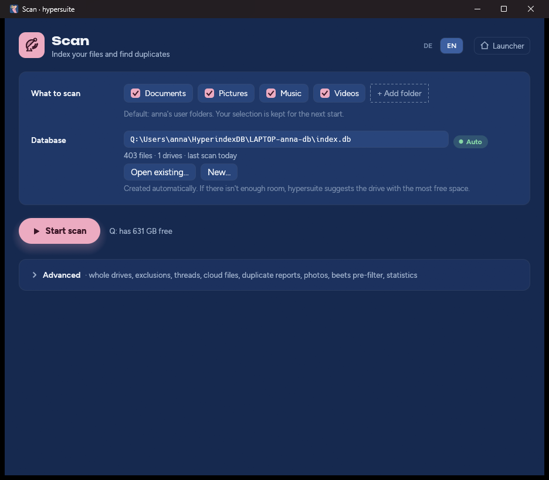
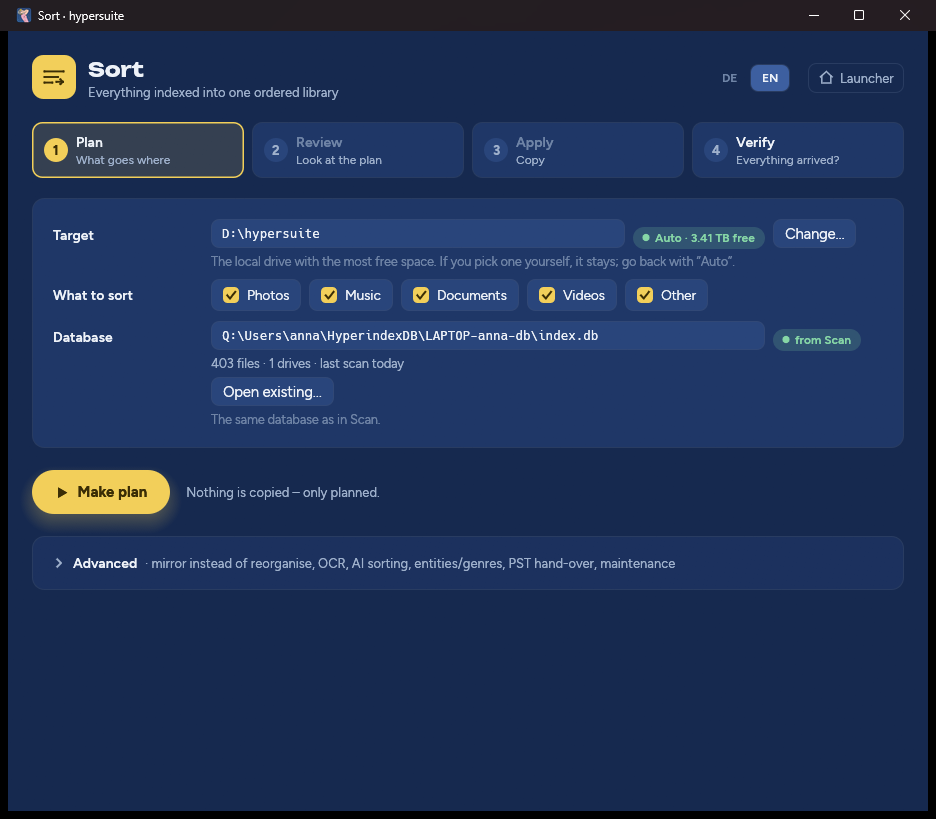
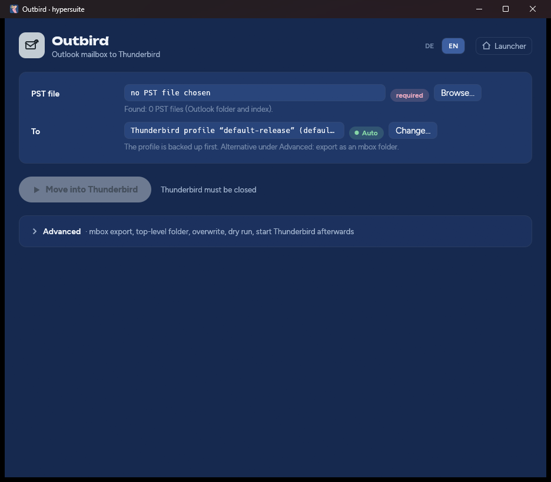

# hypersuite 2.1 – User manual

**Index · Organise · Move mail.** Your files and your Outlook mail from a
Windows machine – prepared, put in order and ready to use straight away.

Version 2.1.7 · October 2026 · for Windows 10 and 11 (64-bit)

<!-- pdf:part -->
## Part I – What hypersuite does for you

Over the years every Windows PC collects a small universe of its own: photos
from the phone and from three old cameras, music from CDs and downloads,
invoices, contracts and tax papers, films, backups of backups – spread across
the internal disk, two USB drives, a pile of sticks and a cloud folder. On top
of that, an Outlook mailbox with twenty years of correspondence in a single,
hard-to-reach PST file.

**hypersuite puts all of that in order – and onto a drive of your choice.**
It indexes every file on every drive, finds duplicates, sorts the whole
collection into a clear folder structure that people can read, and puts it on,
for example, a backup drive. The result is plain Windows folders and files:
you open them in Explorer, in the Photos app, in Word or in your media player
– **straight away, with no special software, no import, no proprietary archive
format.**

And your mail? hypersuite moves it from Outlook to **Thunderbird – with the
complete folder structure, 1:1.** Inbox, Sent Items and every subfolder you
created appear in Thunderbird exactly as you kept them in Outlook, with all
attachments.

All in **one single program file**: no installation, no administrator rights,
no cloud, no account. hypersuite works entirely on your computer and does not
open a single network connection.

### What hypersuite is especially good for

- **Moving to a new PC** – back up everything that matters from the old
  computer, in order, and keep using it on the new one right away.
- **Backups with a system** – instead of copies of unsorted copies, a clean,
  duplicate-free library on the backup drive.
- **Tidying up after years** – see what really is duplicated, on which drives,
  in which folders.
- **Leaving Outlook** – move a mailbox or a whole archive of PST files to
  Thunderbird without losing a single folder.
- **Estates and closing a business** – hand over the data of a computer
  completely, traceably and in order.

<!-- pdf:module scan -->
### Scan – the memory of your drives

**Before you can put things in order, you need to know what is there.** Scan
reads every drive, every folder and every file and builds a precise index:
name, location, size, date – and a digital fingerprint of the content (a
BLAKE3 checksum). Two files with the same fingerprint are identical bit for
bit, whatever they are called and wherever they are.

**Scan forgets nothing.** A USB stick you read in today and unplug next month
stays in the index – recognised by its serial number, not by its drive letter.
So Scan finds duplicates across everything you have ever indexed, including
drives that are lying in a drawer right now.

**Scan is fast when it matters.** On the second run it only reads what has
changed. An interrupted scan – power cut, restart, window closed – continues
with one click, without reading what is already indexed again. Before it
starts, Scan checks that there is enough room for its index and, if needed,
suggests the drive with the most free space.

**Scan changes nothing.** It only reads. The reports on duplicate files and
duplicate folders show what could safely be removed – you decide and delete
yourself. For photos, Scan also works out the date taken and – for pictures
with GPS data – the place, using a built-in place database, without a location
ever leaving your computer.

<!-- pdf:module sort -->
### Sort – your library, ready to use

**Chaos becomes a library.** Sort takes everything Scan has indexed and builds
one clearly structured folder tree from it – on the internal disk, an external
drive or any other target you choose:

- **Photos** by year and month, with date taken and place in the file name –
  RAW and JPEG, Live Photos and sidecar files stay together.
- **Music** by artist, year and album, tracks with their track number.
- **Videos** split into films, series (season, episode) and your own
  recordings.
- **Documents** by tax, administration, business, family and identity – with
  the date from the document itself, optionally with text recognition for
  scanned PDFs and with a local AI model that learns from your examples.
- **Everything else** – programs, archives, other files – unchanged, with its
  original path.

**The result is ordinary folders and files.** No container, no database
format, no dependency on hypersuite: connect the backup drive to any Windows
computer, and your photos, music and documents are there at once – in
Explorer, in the Photos app, in Word. Every file is in the library exactly
once, even if it was scattered five times across four drives before.

**Safety in four steps.** *Plan* – Sort decides what goes where without
touching a file. *Review* – you see the plan before anything happens. *Apply*
– Sort copies and compares every copy with the fingerprint of the original.
*Verify* – the whole library is checked again. Your originals stay untouched
throughout. Whatever cannot be placed with confidence is not guessed at but
stored unchanged in the archive – nothing gets lost.

If you want to keep your familiar folder structure, switch to **Mirror**: Sort
then brings all drives together on one target, 1:1 with their original
folders – ideal as a complete backup of an old computer.

<!-- pdf:module mail -->
### Outbird – Outlook to Thunderbird, folder by folder

**Your whole mailbox moves.** Outbird opens Outlook data files (PST) directly
– Outlook does not even need to be installed – and transfers them to
Thunderbird, Mozilla's free mail client.

**The folder structure is kept 1:1.** This is the decisive advantage: every
folder you created in Outlook over the years – projects, customers, years,
folders within folders – appears in Thunderbird in the same hierarchy, with
the same names, with every single message. No re-sorting, no hunting for lost
subfolders.

**Complete down to the detail.** Sender, recipients, date and the original
headers of every mail, plain-text and HTML content, every attachment bit for
bit – including mails attached to other mails, with their own attachments.
Signed messages stay validly signed. After the conversion Outbird counts
again: every folder and every message is checked against the PST file.

**Safe for your existing Thunderbird.** Before Outbird writes anything, it
checks that Thunderbird is closed and backs up your complete Thunderbird
profile. Each PST file goes into its own folder under *Local Folders* – several
mailboxes do not get mixed up. Alternatively, Outbird exports to a standalone
mbox folder, for example straight onto the backup drive, without touching
Thunderbird at all.

### Built for trust

- **Read first, then copy, then check.** Scan only reads. Sort copies and
  verifies every copy. Files are deleted only on your explicit command – and
  never a file whose copy has not been proven correct.
- **Duplicates by content.** A duplicate means: the same size and the same
  BLAKE3 checksum over the entire content – no sampling, no comparison by
  name or date. The reports only recommend; nothing is deleted.
- **Plan first, then copy.** Plan and Review in Sort are the dry run: you see
  where every file would go before a single one is copied.
- **The PST stays untouched.** Outbird opens the PST file read-only, backs up
  the whole Thunderbird profile before it writes anything into it, and only
  writes once the conversion has been checked and Thunderbird is closed.
- **Offline.** No telemetry, no background updates, no account. The language
  model, text recognition (German, English, French, Italian, Spanish,
  Russian), PDF rendering and music fingerprints are built in.
- **Interruptible.** Every long operation can be stopped and continued later
  exactly where it left off.
- **Bilingual.** User interface in German and English, switchable with one
  click.
- **One file.** `hypersuite.exe` fits on a USB stick and runs on any Windows 10
  and 11 without installation.

<!-- pdf:part -->
## Part II – Operating instructions

### 1. Requirements

| | |
|---|---|
| Operating system | Windows 10 or Windows 11, 64-bit |
| Rights | Normal user rights are enough; no installation |
| Space for the program | about 230 MB for `hypersuite.exe`, about 260 MB on first start for the bundled tools |
| Space for the index | about 1 GB per 1.3 million indexed files – Scan checks this in advance |
| Space for the library | up to the size of all data to be organised, because Sort copies |
| For Outbird | Thunderbird (when moving into the profile); not needed for the mbox export |

### 2. Download, check, start

1. From the latest release at
   <https://github.com/namshubs/hypersuite/releases/latest>, download the file
   `hypersuite.exe` and the file `SHA256SUMS.txt`.
2. **Check the download** (recommended). Open PowerShell in the download
   folder and enter:

   ```powershell
   Get-FileHash .\hypersuite.exe -Algorithm SHA256
   Get-Content .\SHA256SUMS.txt
   ```

   The value for `hypersuite.exe` must be identical in both outputs. The
   release notes also link the **VirusTotal** report for exactly this SHA-256
   value – the verdict of about 70 virus scanners on exactly this file.
3. Put `hypersuite.exe` anywhere you like – Downloads, a tools folder or a USB
   stick.
4. **Double-click.** The first time, Windows may show *"Windows protected your
   PC"*. Click **More info** and then **Run anyway**. The file is digitally
   signed (publisher *hypersuite (github.com/namshubs/hypersuite)*); because
   the certificate is self-issued, Windows does not know it at first.
5. On the first start of each version, hypersuite unpacks its tools for a few
   seconds. **Bundled tools ready** then appears at the bottom left.

> **Trust the certificate permanently (optional).** Also download
> `hypersuite-codesign.cer` and run in an administrator command prompt:
> `certutil -addstore Root hypersuite-codesign.cer` and
> `certutil -addstore TrustedPublisher hypersuite-codesign.cer`.
> Windows then shows *hypersuite (github.com/namshubs/hypersuite)* as a
> verified publisher.

### 3. The launcher


The launcher is the start page. Each of the three cards opens a module in its
own window:

- **Scan** – shows when the last scan ran and how many files are indexed.
- **Sort** – shows the library target and the free space there.
- **Outbird** – shows how many PST files were found and which Thunderbird
  profile is used.

Scan and Sort can be open at the same time. Clicking the card of a module that
is already open brings its window to the front. In the footer you find
**Tools** (state of the bundled tools), **About** (version, licence,
third-party software) and the language switch **DE | EN**.

#### Auto and Manual

Many settings carry a chip: **● Auto** means hypersuite works out the value
itself – anew on every start. As soon as you change it, it becomes **Manual**
and stays that way. Clicking the *Manual* chip returns to the automatic value.
Under **Advanced** each module has all further options; **Reset … settings to
defaults** sets everything there back to Auto.

### 4. Step by step: from the old PC to the backup drive

This chapter describes the typical use: bringing all files and the Outlook
mailbox of a Windows computer onto an external drive, in order, so that
everything can be used straight away.

1. **Connect the backup drive.** An empty or sufficiently large external
   drive, e.g. drive `E:`.
2. **Open Scan.** Choose what to index: the user folders (Documents, Pictures,
   Music, Videos, Desktop) are preselected. For the whole computer, open
   **Advanced → Sources → All local drives**. Connect further drives (old USB
   disks, sticks) and scan them too.
3. **Start the scan.** Scan first counts the files, checks the space and then
   indexes everything. With large collections this can take hours – you can
   stop at any time and **Continue** later.
4. **Enrich photos.** In Scan under **Advanced → Photos → Enrich photos**. This
   sorts photos by their real date taken.
5. **Optional: look at duplicates.** **Advanced → Duplicates and reports →
   Report: duplicate folders** shows what exists more than once. The library
   does not need this – Sort takes every file only once anyway.
6. **Open Sort and choose the target.** Under **Target**, click **Change…** and
   choose a folder on the backup drive, e.g. `E:\hypersuite`.
7. **Plan, Review, Apply, Verify** – the four steps at the top of the window,
   one after the other. Before applying, Sort asks once more.
8. **Open Outbird** and move the Outlook file (see chapter 7): either directly
   into Thunderbird or – for the backup drive – under **Advanced → Destination
   → mbox folder** as an export to `E:\hypersuite\mboxemails\`.
9. **Done.** The backup drive now holds a complete, organised copy. Open it in
   Explorer – everything is ready to use.

> **The originals stay where they are.** Only once the library has been
> verified and additionally backed up can you clear away the originals with
> *Quarantine* and *Purge* (chapter 6.6). This is optional.

### 5. Scan in detail



#### 5.1 What to scan

The buttons **Documents, Pictures, Music, Videos, Desktop** stand for your
Windows user folders and are preselected; **Downloads** is off. One click
switches a folder on or off. **Add folder** adds any other folder. Your
selection is saved.

#### 5.2 The database

The index of all files is a database file. hypersuite creates it
automatically: `%USERPROFILE%\HyperindexDB\<Computer>-<User>-db\index.db`.
Scan and Sort use the same database.

- Below the path you see how many files and drives it contains and when the
  last scan ran.
- **Open existing…** uses an existing database – for example from an earlier
  run – and takes over the folders and options of its last scan.
- **New…** creates a new database in a folder of your choice.
- **Recently used…** lists the last five databases.
- If a chosen file is not a valid database, it is shown in red and **Start
  scan** stays locked.
- If there is not enough space on the database's drive, a dialog suggests the
  drive with the most free space (or **Other folder…**).

#### 5.3 Starting and continuing a scan

**Start scan** first counts the files (**Start without counting** skips that)
and then shows a progress bar with the time remaining. **Show details** opens
the full log.

If a scan was interrupted, the next time you open Scan the card **The last
scan was interrupted** appears with the drives still to do. **Continue** picks
up exactly there.

Repeated scans are fast: unchanged files are not read again. Scanning again
regularly is the intended way to keep the index up to date.

#### 5.4 Advanced

| Section | Option | Meaning |
|---|---|---|
| Sources | All local drives | All drives instead of the folder selection |
| | including network drives | connected network drives as well |
| | Follow links/junctions | off by default, to avoid loops |
| | Re-hash everything | check every file again – detects creeping data corruption |
| | Online-only files (OneDrive) | **skip**: record only name, size and date, download nothing; **download and hash**: read in full |
| | Exclude folders | folder names skipped everywhere, e.g. `node_modules, .git` |
| | Threads | number of parallel readers; blank = automatic |
| Duplicates and reports | Report folder | default `Documents\hypersuite` |
| | Ignore files smaller than (bytes) | default 4096 bytes |
| | Report: duplicate files | every group of identical files, with a recommendation of which one stays |
| | Report: duplicate folders | folders whose content exists completely elsewhere |
| Photos | Enrich photos | work out date taken and place (offline) |
| | Plan / apply / undo photo library | a separate, photos-only library; use Sort for everything else |
| Music | Beets pre-filter | prepares music for the program *beets* |
| Look inside | Volumes, Statistics, Action log | what the index contains and what was planned |

The reports are saved as a Markdown file and as a JSON file and delete
nothing.

### 6. Sort in detail



#### 6.1 Target and classes

**Target** is the library folder. Automatically, Sort chooses a folder
`hypersuite` on the local drive with the most free space. For a backup drive,
use **Change…** to choose a folder on it. If the target is on a drive you have
also scanned, Sort points this out – it works, but a separate drive is safer.

**What to sort:** Photos, Music, Documents, Videos and Other – all
preselected.

#### 6.2 The four steps

| Step | Button | What happens |
|---|---|---|
| 1 Plan | **Make plan** | Sort decides for every file where it goes. Nothing is copied. The plan gets a number and a report in the target's `.hyperfiler\plans` folder. |
| 2 Review | **Review plan** | Overview: how many files go where, and why files end up in the archive or in the document inbox. Open the report as Markdown or JSON. |
| 3 Apply | **Apply…** | After confirmation: copy, check every copy against its fingerprint, mark it as done. |
| 4 Verify | **Verify** | Reads every file in the library again and compares it. Changes nothing. |

*Apply* can be interrupted at any time; starting it again carries on, and
finished copies are recognised. If a source file has changed since planning,
it fails instead of being copied wrongly – plan again in that case.

#### 6.3 Library layout

```
E:\hypersuite\
├── Photo\2024\2024-07\20240714_Lugano_IMG_0412.jpg
├── Music\Queen\1975 - A Night at the Opera\11 - Bohemian Rhapsody.mp3
├── Video\
│   ├── Movies\Inception (2010)\Inception (2010) - 1080p.mkv
│   ├── Series\Dark (2017)\Season 01\Dark - S01E01 - Secrets.mkv
│   └── Home\2023\2023-12\20231224_Family.mp4
├── Docs\
│   ├── Tax\2023\Tax return - Tax office - 2024-05-02.pdf
│   ├── Administration\2024\Invoice\City utilities - Invoice - 2024-03-01.pdf
│   ├── Business\Clients\<Client>\2024\…
│   ├── Family\2022\…
│   ├── Identity\Passport_Anna.pdf
│   └── Inbox\2024-03\Scan_017__a1b2c3d4.pdf
├── Archive\<drive serial number>\<original path>
└── .hyperfiler\   (plans, quarantine)
```

- **Photos** are filed by date taken (run *Enrich photos* first); the place
  comes from GPS data. RAW and JPEG pairs, XMP files and Live Photo videos
  stay together.
- **Music** is filed by its tags; if they are missing, Sort takes them from an
  acoustically identical copy that has them.
- **Videos** are recognised by their file name (`Title (2019) 1080p`,
  `Series S01E02`), then by embedded data and `.nfo` files. Everything else
  counts as your own recording.
- **Documents** (PDF, Word `.docx`/`.doc`, OpenDocument `.odt`, text) are read
  and filed by fixed rules. Whatever cannot be placed with confidence goes to
  `Docs\Inbox` – nothing is guessed.
- **Other** files are taken over unchanged.
- **Archive** is the safety net: files without usable information are stored
  bit for bit with their original path under the serial number of their
  drive.

Files with the same name but different content are both kept (`-v1`, `-v2` by
date, or with the drive serial number). Identical files end up in the library
exactly once.

#### 6.4 Advanced: mode and documents

- **Reorganise (library layout)** – the layout above (default).
- **Mirror (source structure 1:1)** – no sorting: everything is copied with
  its original folder structure to `Archive\<serial number>\…`. Ideal for
  bringing several drives together unchanged on one backup drive.
- **entities.toml** – your own companies, clients and people, so that
  documents are filed under their names:

  ```toml
  [[entity]]
  name = "City Utilities Munich"
  aliases = ["SWM"]
  role = "vendor"          # vendor (sender), client, holder
  class = "administration" # tax, administration, business, family, identity

  [[entity]]
  name = "Anna Example"
  role = "holder"          # whose passport, ID card or certificate
  ```

- **OCR pages** – read scanned PDFs up to this number of pages with text
  recognition (blank = off; a few seconds per page).
- **AI document sorting** – a bundled, multilingual language model files
  documents that would otherwise go to the inbox. It learns from examples you
  label with `hypersuite file inbox-review` and runs completely offline.
- **genres.toml** – your mapping of film titles to genres:

  ```toml
  [movies]
  "The Matrix" = "Sci-Fi"
  "The Godfather" = "Drama"
  ```

#### 6.5 PST files in the index

Outlook files that Scan found on your drives can be processed by Sort in one
go: **Search the index**, then **Ignore** (archived like other files), **As
mbox into the target** (to `<target>\mboxemails\<name>`) or **Into a
Thunderbird profile**, and finally **Process found mail**.

#### 6.6 Maintenance: quarantine, purge, find

Once the library has been verified **and backed up separately**, the
originals can go – deliberately in two steps:

1. **Quarantine** moves the originals of all verified copies to
   `<target>\.hyperfiler\quarantine\…`. Nothing is deleted. Before each move,
   the copy in the library is checked once more.
2. **Purge** removes files that have been in quarantine longer than the set
   grace period (default 30 days). It is the **only** step in hypersuite that
   deletes anything. It requires a note from you under *Backup confirmed*
   (e.g. "NAS backup 25 Oct 2026") and never deletes a file whose copy in the
   library no longer checks out. There is no undo.

**Find** finds documents by their meaning rather than by exact words – "car
insurance renewal" also finds the letter in which these words do not appear,
across languages. Before the first search, run **Rebuild the search index**
once.

### 7. Outbird in detail



#### 7.1 The PST file

Outbird suggests PST files that it finds in the usual Outlook folders
(`Documents\Outlook Files`, `%LOCALAPPDATA%\Microsoft\Outlook`) and among the
scanned files. Use **Browse…** to choose any other. After you choose one,
Outbird shows how many folders and messages the file contains.

> **Exchange, Microsoft 365, IMAP:** Outlook does not store these accounts as
> PST but as a cache (OST). Export the mailbox in Outlook first: *File → Open &
> Export → Import/Export → Export to a file → Outlook Data File (.pst)*.

#### 7.2 Moving into Thunderbird

1. Under **To** you see your Thunderbird profile; automatically the default
   profile, another one with **Change…**.
2. **Close Thunderbird.** Outbird checks this.
3. Tick *I understand this modifies my live Thunderbird profile*, click
   **Move into Thunderbird** and confirm.

Outbird then backs up the whole profile (`outbird-backup-<date>` next to the
profile folder), converts the PST file into a folder `<name>-thunderbird` next
to the PST file, checks the result folder by folder and message by message,
and only then copies everything into the profile's **Local Folders**. If the
check fails, the profile stays untouched. Afterwards Thunderbird starts – your
Outlook folders appear there in the same structure, in a folder named after
the PST file.

#### 7.3 Exporting as an mbox folder

**Advanced → Destination → mbox folder** writes a standalone folder of
Thunderbird-compatible mbox files – without touching any Thunderbird
installation. Ideal for the backup drive. Default location:
`<Sort target>\mboxemails\<name of the PST>`. Later this folder can be copied
into the *Local Folders* of a Thunderbird profile.

#### 7.4 Advanced

| Option | Meaning |
|---|---|
| Everything under one top-level folder | on by default; blank = name of the PST file. Leave it on with several PST files so that their inboxes do not get mixed up. |
| Overwrite existing mailboxes/folders | off by default: Outbird stops instead of overwriting. |
| Dry run | everything except writing |
| Start Thunderbird afterwards | on by default |
| Inspect | read folders and message counts, write nothing |

Outbird transfers **e-mail**. Contacts and calendar entries are not moved into
Thunderbird's address book or calendar.

### 8. Command line (quick reference)

Everything the windows do is also available on the command line. In the
command prompt, put `start /wait` in front; in PowerShell, append
`| Out-Host`.

```bat
start /wait hypersuite index scan E:\ --db D:\index.db
start /wait hypersuite index scan --resume
start /wait hypersuite file plan E:\hypersuite --db D:\index.db
start /wait hypersuite file apply <PLAN-NUMBER> E:\hypersuite --db D:\index.db
start /wait hypersuite mail export C:\mail\archive.pst --root-name ""
start /wait hypersuite tools --verify
```

`hypersuite <command> --help` shows the full help with examples. The detailed
reference:
<https://github.com/namshubs/hypersuite/blob/main/docs/command-line.md>.

### 9. Files, settings, privacy

| What | Where |
|---|---|
| Settings | `%LOCALAPPDATA%\hypersuite\settings.json` |
| Bundled tools | `%LOCALAPPDATA%\hypersuite\runtime\` (older versions are removed) |
| Database | `%USERPROFILE%\HyperindexDB\<Computer>-<User>-db\index.db` |
| Scan reports | `Documents\hypersuite\` |
| Library | `<drive>:\hypersuite\` or your chosen target |
| Quarantine | `<target>\.hyperfiler\quarantine\` |
| Thunderbird backup | `%APPDATA%\Thunderbird\Profiles\outbird-backup-<date>\` |

hypersuite writes nothing to the registry or to *Program Files*. The database
contains the names and locations of your files, but no content – treat it
like a table of contents of your drives.

**Uninstalling:** delete `hypersuite.exe`, delete `%LOCALAPPDATA%\hypersuite\`
and, if you like, the database, reports and library.

### 10. Troubleshooting

| Problem | Solution |
|---|---|
| SmartScreen warning | **More info → Run anyway**, or trust the certificate (chapter 2) |
| "Tools missing – see Tools" | **Tools → Unpack again**; needs about 260 MB free in `%LOCALAPPDATA%` |
| Nothing appears in the command prompt | use `start /wait hypersuite …` |
| Scan hangs on one file | usually a cloud file or a slow drive; exclude the folder or set *Online-only files: skip*; stopping and **Continue** loses nothing |
| "Not a hyperindex database" | choose the right file with **Open existing…** or **New…** |
| Sort says "Scan first" | run Scan first or choose an existing index |
| Many documents in `Docs\Inbox` | maintain `entities.toml`, switch on OCR, AI sorting with your own examples |
| Files in `Archive` instead of Photos/Music | *Enrich photos* before planning; scan cloud files with *download and hash* |
| "Thunderbird appears to be running" | quit Thunderbird completely (also from the notification area) |
| "… already exists in the Thunderbird profile" | keep *Everything under one top-level folder* on, or use a different name |
| No Thunderbird profile found | install Thunderbird and start it once – or export as mbox |

Report problems and ask questions: <https://github.com/namshubs/hypersuite/issues>
– with the version (`hypersuite --version`) and the text under **Show
details**.

### 11. Licence

hypersuite is licensed under the **Sustainable Use License 1.0**: free to use
for private, non-commercial and internal business purposes and free to pass on
for non-commercial purposes; selling hypersuite or offering it to others
commercially is not allowed. No warranty (file `LICENSE`, copyright notice in
`NOTICE`). hypersuite is **not open-source software**; the source code is
available on request (see *Source code and contributing*). Version 2.1.3 was
released under the Apache License 2.0; since 2.1.4 the new licence applies for
the reasons given there – a copy of 2.1.3 you already have stays under Apache
2.0. The bundled third-party components keep their own licences; the list is
in the program under **About**, and the source code of the GPL/LGPL
components comes with every release as `third-party-sources.zip`.

#### Use at your own risk

You use hypersuite at your own risk. There is no organised support. Like any
software, hypersuite may contain errors – keep your original data and an
independent backup until you have checked the result yourself.

Or, as legend has it was written – presumably by Bill Gates's father, the
lawyer – on the back of the first Z-80 emulation cards:

> "In the legal sense: we deny that this software is fit for any purpose
> whatsoever."

#### Source code and contributing

Development happens on a self-hosted, independent Git server; only the
releases and the documentation are published. This is deliberate: the code
and its core ideas should not end up in the training data of large AI models,
and the direction of the project stays in the author's hands.

Feedback, bug reports and ideas are always welcome. Source access is for
people who share the project's goal – helping people leave Outlook, clean up
Windows and prepare the switch to Linux – and bring four things: being human
(no AI as a contributor; AI as a tool is fine), no ties to Big Tech, commitment
to privacy and user rights, and a technical improvement agenda. Requests go
through a Discussion in the "Contributor access" category or an issue with the
*Contributor access* template; this is followed by an interactive onboarding
and signing the Contributor Agreement. Details: `CONTRIBUTING.md` and
`CONTRIBUTOR-AGREEMENT.md` in the project's `.github` folder.

Project: <https://github.com/namshubs/hypersuite>
