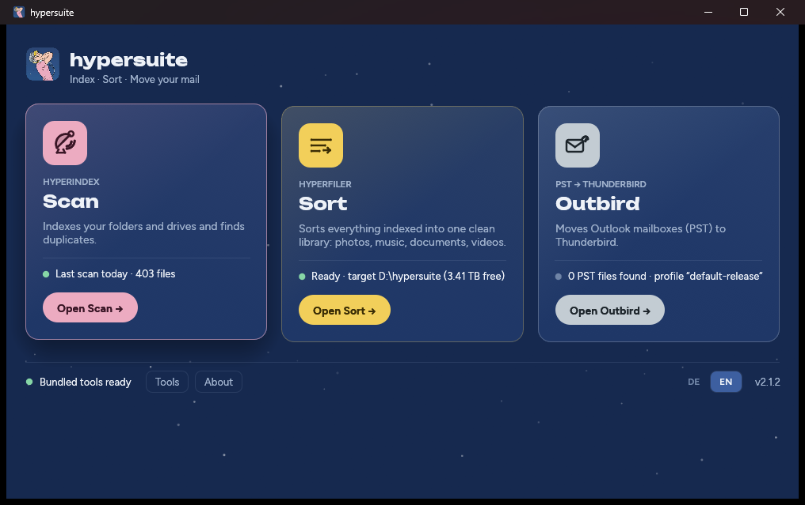
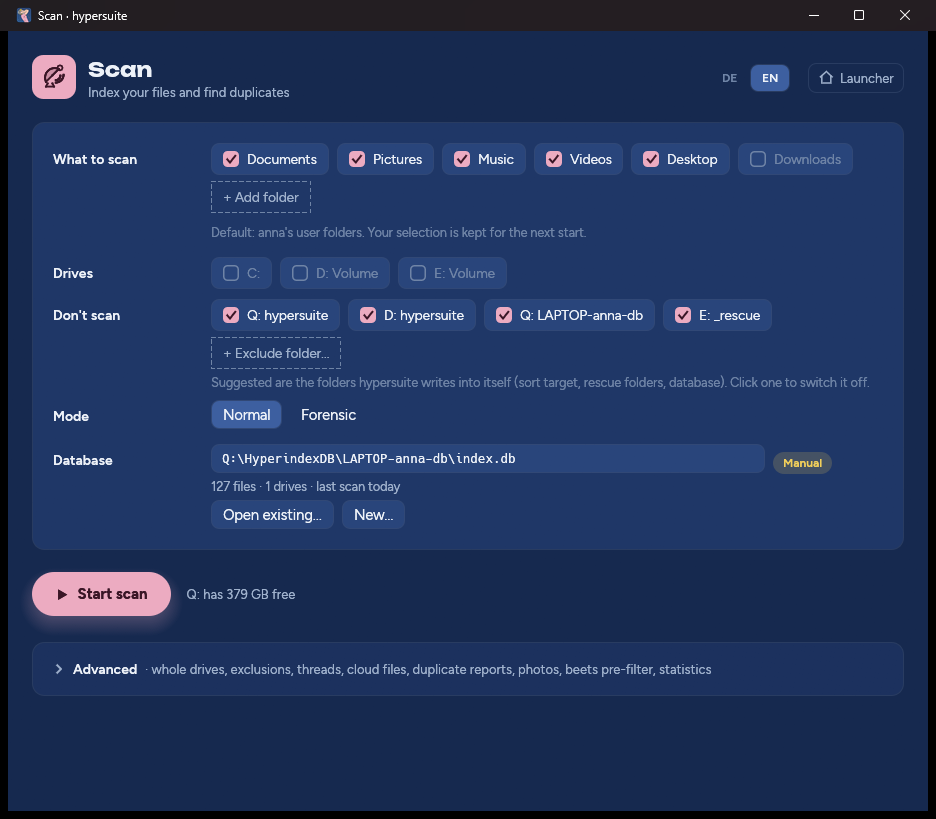
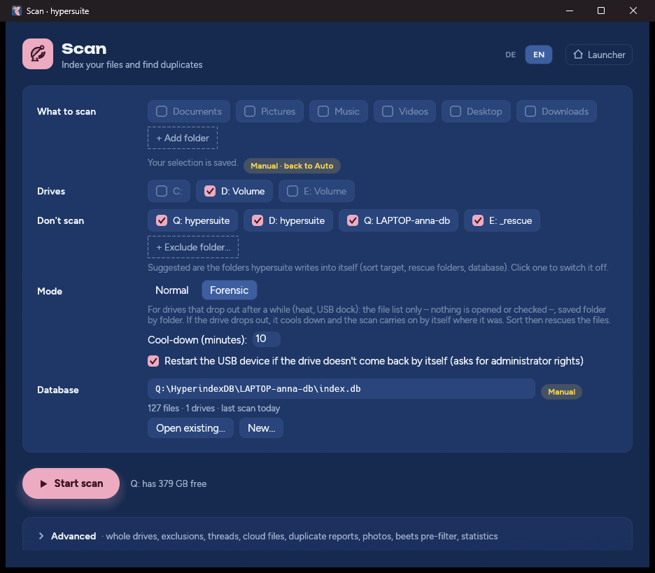
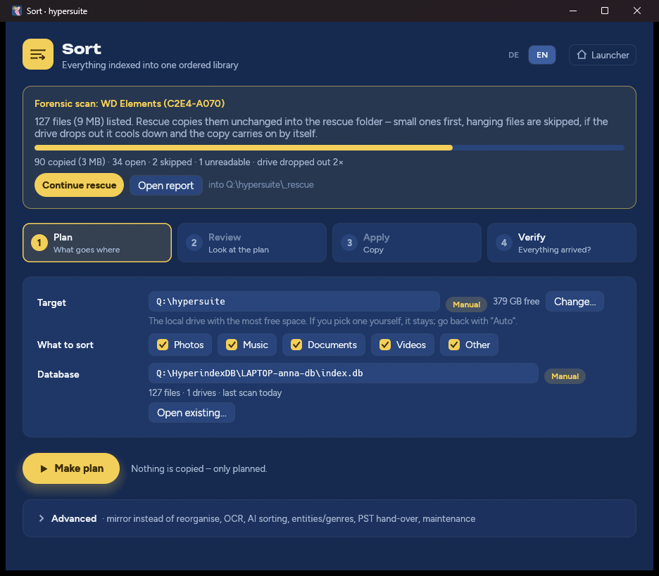
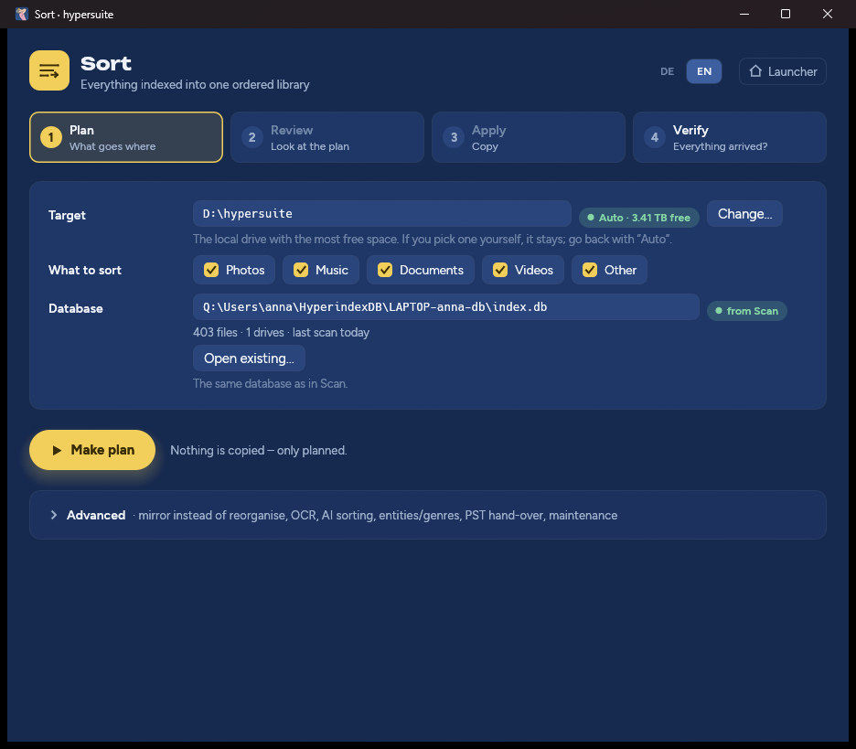
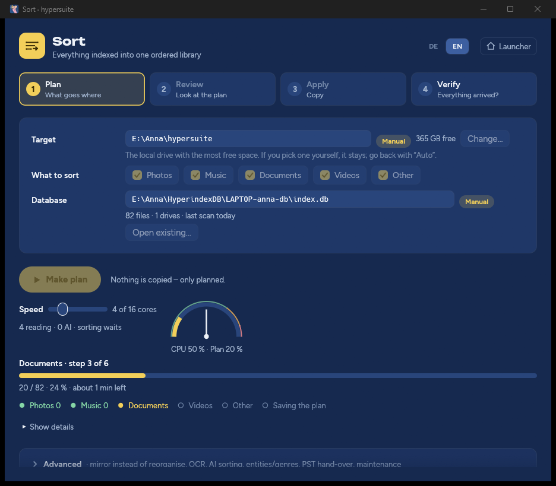
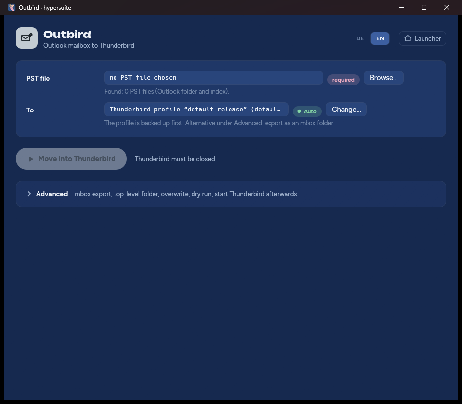

# hypersuite 2.2 – User manual

**Index · Organise · Move mail.** Your files and your Outlook mail from a
Windows machine – prepared, put in order and ready to use straight away.

Version 2.2.2 · November 2026 · for Windows 10 and 11 (64-bit)

<!-- pdf:part -->
## Part I – What hypersuite does for you

Over the years every Windows PC collects a small universe of its own: photos
from the phone and from three old cameras, music from CDs and downloads,
invoices, contracts and tax papers, films, backups of backups – spread across
the internal disk, two USB drives, a pile of sticks and a cloud folder. On top
of that, an Outlook mailbox with twenty years of correspondence in a single,
hard-to-reach PST file.

**hypersuite puts all of that in order – and onto a drive of your choice.**
It indexes every file on every drive, finds duplicates, sorts the whole
collection into a clear folder structure that people can read, and puts it on,
for example, a backup drive. The result is plain Windows folders and files:
you open them in Explorer, in the Photos app, in Word or in your media player
– **straight away, with no special software, no import, no proprietary archive
format.**

And your mail? hypersuite moves it from Outlook to **Thunderbird – with the
complete folder structure, 1:1.** Inbox, Sent Items and every subfolder you
created appear in Thunderbird exactly as you kept them in Outlook, with all
attachments.

All in **one single program file**: no installation, no administrator rights,
no cloud, no account. hypersuite works entirely on your computer and does not
open a single network connection.

### What hypersuite is especially good for

- **Moving to a new PC** – back up everything that matters from the old
  computer, in order, and keep using it on the new one right away.
- **Backups with a system** – instead of copies of unsorted copies, a clean,
  duplicate-free library on the backup drive.
- **Tidying up after years** – see what really is duplicated, on which drives,
  in which folders.
- **Leaving Outlook** – move a mailbox or a whole archive of PST files to
  Thunderbird without losing a single folder.
- **Estates and closing a business** – hand over the data of a computer
  completely, traceably and in order.
- **Rescue from an ageing drive** – read a hard drive that gets hot and drops
  out after a few minutes piece by piece, until everything readable is safe.

<!-- pdf:module scan -->
### Scan – the memory of your drives

**Before you can put things in order, you need to know what is there.** Scan
reads every drive, every folder and every file and builds a precise index:
name, location, size, date – and a digital fingerprint of the content (a
BLAKE3 checksum). Two files with the same fingerprint are identical bit for
bit, whatever they are called and wherever they are.

**Scan forgets nothing.** A USB stick you read in today and unplug next month
stays in the index – recognised by its serial number, not by its drive letter.
So Scan finds duplicates across everything you have ever indexed, including
drives that are lying in a drawer right now.

**Scan is fast when it matters.** On the second run it only reads what has
changed. An interrupted scan – power cut, restart, window closed – continues
with one click, without reading what is already indexed again. Before it
starts, Scan checks that there is enough room for its index and, if needed,
suggests the drive with the most free space.

**Scan changes nothing.** It only reads. The reports on duplicate files and
duplicate folders show what could safely be removed – you decide and delete
yourself. For photos, Scan also works out the date taken and – for pictures
with GPS data – the place, using a built-in place database, without a location
ever leaving your computer.

**Scan rescues what is about to fail.** An old drive that gets hot after ten
minutes, or a USB dock that keeps disconnecting: in **forensic mode** Scan reads
only the file list, saves it folder by folder and, after every drop-out,
carries on where the drive stopped. Sort then copies the files off – the small
ones first, hanging files are skipped instead of waited for. If the drive drops
out, hypersuite lets it cool down, waits for it to come back and continues by
itself; after the first drop-out it takes the break **before** the drive fails
again.

<!-- pdf:module sort -->
### Sort – your library, ready to use

**Chaos becomes a library.** Sort takes everything Scan has indexed and builds
one clearly structured folder tree from it – on the internal disk, an external
drive or any other target you choose:

- **Photos** by year and month, with date taken and place in the file name –
  RAW and JPEG, Live Photos and sidecar files stay together.
- **Music** by artist, year and album, tracks with their track number.
- **Videos** split into films, series (season, episode) and your own
  recordings.
- **Documents** by tax, administration, business, family and identity – with
  the date from the document itself, optionally with text recognition for
  scanned PDFs and with a local AI model that learns from your examples.
- **Everything else** – programs, archives, other files – unchanged, with its
  original path.

**The result is ordinary folders and files.** No container, no database
format, no dependency on hypersuite: connect the backup drive to any Windows
computer, and your photos, music and documents are there at once – in
Explorer, in the Photos app, in Word. Every file is in the library exactly
once, even if it was scattered five times across four drives before.

**Safety in four steps.** *Plan* – Sort decides what goes where without
touching a file. *Review* – you see the plan before anything happens. *Apply*
– Sort copies and compares every copy with the fingerprint of the original.
*Verify* – the whole library is checked again. Your originals stay untouched
throughout. Whatever cannot be placed with confidence is not guessed at but
stored unchanged in the archive – nothing gets lost.

If you want to keep your familiar folder structure, switch to **Mirror**: Sort
then brings all drives together on one target, 1:1 with their original
folders – ideal as a complete backup of an old computer.

<!-- pdf:module mail -->
### Outbird – Outlook to Thunderbird, folder by folder

**Your whole mailbox moves.** Outbird opens Outlook data files (PST) directly
– Outlook does not even need to be installed – and transfers them to
Thunderbird, Mozilla's free mail client.

**The folder structure is kept 1:1.** This is the decisive advantage: every
folder you created in Outlook over the years – projects, customers, years,
folders within folders – appears in Thunderbird in the same hierarchy, with
the same names, with every single message. No re-sorting, no hunting for lost
subfolders.

**Complete down to the detail.** Sender, recipients, date and the original
headers of every mail, plain-text and HTML content, every attachment bit for
bit – including mails attached to other mails, with their own attachments.
Signed messages stay validly signed. After the conversion Outbird counts
again: every folder and every message is checked against the PST file.

**Safe for your existing Thunderbird.** Before Outbird writes anything, it
checks that Thunderbird is closed and backs up your complete Thunderbird
profile. Each PST file goes into its own folder under *Local Folders* – several
mailboxes do not get mixed up. Alternatively, Outbird exports to a standalone
mbox folder, for example straight onto the backup drive, without touching
Thunderbird at all.

### Built for trust

- **Read first, then copy, then check.** Scan only reads. Sort copies and
  verifies every copy. Files are deleted only on your explicit command – and
  never a file whose copy has not been proven correct.
- **Duplicates by content.** A duplicate means: the same size and the same
  BLAKE3 checksum over the entire content – no sampling, no comparison by
  name or date. The reports only recommend; nothing is deleted.
- **Plan first, then copy.** Plan and Review in Sort are the dry run: you see
  where every file would go before a single one is copied.
- **The PST stays untouched.** Outbird opens the PST file read-only, backs up
  the whole Thunderbird profile before it writes anything into it, and only
  writes once the conversion has been checked and Thunderbird is closed.
- **Offline.** No telemetry, no background updates, no account. The language
  model, text recognition (German, English, French, Italian, Spanish,
  Russian), PDF rendering and music fingerprints are built in.
- **Interruptible.** Every long operation can be stopped and continued later
  exactly where it left off.
- **Bilingual.** User interface in German and English, switchable with one
  click.
- **One file.** `hypersuite.exe` fits on a USB stick and runs on any Windows 10
  and 11 without installation.

<!-- pdf:part -->
## Part II – Operating instructions

### 1. Requirements

| | |
|---|---|
| Operating system | Windows 10 or Windows 11, 64-bit |
| Rights | Normal user rights are enough; no installation |
| Space for the program | about 230 MB for `hypersuite.exe`, about 260 MB on first start for the bundled tools |
| Space for the index | about 1 GB per 1.3 million indexed files – Scan checks this in advance |
| Space for the library | up to the size of all data to be organised, because Sort copies |
| For Outbird | Thunderbird (when moving into the profile); not needed for the mbox export |

### 2. Download, check, start

1. From the latest release at
   <https://github.com/namshubs/hypersuite/releases/latest>, download the file
   `hypersuite.exe` and the file `SHA256SUMS.txt`.
2. **Check the download** (recommended). Open PowerShell in the download
   folder and enter:

   ```powershell
   Get-FileHash .\hypersuite.exe -Algorithm SHA256
   Get-Content .\SHA256SUMS.txt
   ```

   The value for `hypersuite.exe` must be identical in both outputs. The
   release notes also link the **VirusTotal** report for exactly this SHA-256
   value – the verdict of about 70 virus scanners on exactly this file.
3. Put `hypersuite.exe` anywhere you like – Downloads, a tools folder or a USB
   stick.
4. **Double-click.** The first time, Windows may show *"Windows protected your
   PC"*. Click **More info** and then **Run anyway**. The file is digitally
   signed (publisher *hypersuite (github.com/namshubs/hypersuite)*); because
   the certificate is self-issued, Windows does not know it at first.
5. On the first start of each version, hypersuite unpacks its tools for a few
   seconds. **Bundled tools ready** then appears at the bottom left.

> **Trust the certificate permanently (optional).** Also download
> `hypersuite-codesign.cer` and run in an administrator command prompt:
> `certutil -addstore Root hypersuite-codesign.cer` and
> `certutil -addstore TrustedPublisher hypersuite-codesign.cer`.
> Windows then shows *hypersuite (github.com/namshubs/hypersuite)* as a
> verified publisher.

### 3. The launcher



The launcher is the start page. Each of the three cards opens a module in its
own window:

- **Scan** – shows when the last scan ran and how many files are indexed.
- **Sort** – shows the library target and the free space there.
- **Outbird** – shows how many PST files were found and which Thunderbird
  profile is used.

Scan and Sort can be open at the same time. Clicking the card of a module that
is already open brings its window to the front. In the footer you find
**Tools** (state of the bundled tools), **About** (version, licence,
third-party software) and the language switch **DE | EN**.

#### Auto and Manual

Many settings carry a chip: **● Auto** means hypersuite works out the value
itself – anew on every start. As soon as you change it, it becomes **Manual**
and stays that way. Clicking the *Manual* chip returns to the automatic value.
Under **Advanced** each module has all further options; **Reset … settings to
defaults** sets everything there back to Auto.

### 4. Step by step: from the old PC to the backup drive

This chapter describes the typical use: bringing all files and the Outlook
mailbox of a Windows computer onto an external drive, in order, so that
everything can be used straight away.

1. **Connect the backup drive.** An empty or sufficiently large external
   drive, e.g. drive `E:`.
2. **Open Scan.** Choose what to index: the user folders (Documents, Pictures,
   Music, Videos, Desktop) are preselected. For the whole computer, open
   **Advanced → Sources → All local drives**. Connect further drives (old USB
   disks, sticks) and scan them too.
3. **Start the scan.** Scan first counts the files, checks the space and then
   indexes everything. With large collections this can take hours – you can
   stop at any time and **Continue** later.
4. **Enrich photos.** In Scan under **Advanced → Photos → Enrich photos**. This
   sorts photos by their real date taken.
5. **Optional: look at duplicates.** **Advanced → Duplicates and reports →
   Report: duplicate folders** shows what exists more than once. The library
   does not need this – Sort takes every file only once anyway.
6. **Open Sort and choose the target.** Under **Target**, click **Change…** and
   choose a folder on the backup drive, e.g. `E:\hypersuite`.
7. **Plan, Review, Apply, Verify** – the four steps at the top of the window,
   one after the other. Before applying, Sort asks once more.
8. **Open Outbird** and move the Outlook file (see chapter 7): either directly
   into Thunderbird or – for the backup drive – under **Advanced → Destination
   → mbox folder** as an export to `E:\hypersuite\mboxemails\`.
9. **Done.** The backup drive now holds a complete, organised copy. Open it in
   Explorer – everything is ready to use.

> **The originals stay where they are.** Only once the library has been
> verified and additionally backed up can you clear away the originals with
> *Quarantine* and *Purge* (chapter 6.6). This is optional.

### 5. Scan in detail



#### 5.1 What to scan

The buttons **Documents, Pictures, Music, Videos, Desktop** stand for your
Windows user folders and are preselected; **Downloads** is off. One click
switches a folder on or off. **Add folder** adds any other folder. Your
selection is saved.

**Drives** shows every local drive on its own – internal disks as well as USB
drives and docks (label, free space and "removable" when hovering). A ticked
drive is scanned completely, in addition to the selected folders.

**Don't scan** takes folders that are left out with everything below them
(**Exclude folder…**). Suggested and already switched on are the folders
hypersuite writes into itself:

| Suggestion | Why |
|---|---|
| Sort target | otherwise the finished library would be indexed as a duplicate of its own originals |
| `hypersuite` folder | libraries of earlier runs on every drive |
| Database folder | the index itself and its working files |
| Rescue folder | copies from forensic mode (chapter 5.5) |
| Photo library | library folder of *Apply plan* (photos, under Advanced) |

One click switches a suggestion off; the choice is saved. If a folder you want
to scan lies **inside** a suggestion – the rescue folder itself, for example –
that suggestion does not apply and is greyed out.

#### 5.2 The database

The index of all files is a database file. hypersuite creates it
automatically: `%USERPROFILE%\HyperindexDB\<Computer>-<User>-db\index.db`.
Scan and Sort use the same database.

- Below the path you see how many files and drives it contains and when the
  last scan ran.
- **Open existing…** uses an existing database – for example from an earlier
  run – and takes over the folders and options of its last scan.
- **New…** creates a new database in a folder of your choice.
- **Recently used…** lists the last five databases.
- If a chosen file is not a valid database, it is shown in red and **Start
  scan** stays locked.
- If there is not enough space on the database's drive, a dialog suggests the
  drive with the most free space (or **Other folder…**).

#### 5.3 Starting and continuing a scan

**Start scan** first counts the files (**Start without counting** skips that)
and then shows a progress bar with the time remaining. **Show details** opens
the full log.

If a scan was interrupted, the next time you open Scan the card **The last
scan was interrupted** appears with the drives still to do. **Continue** picks
up exactly there.

Repeated scans are fast: unchanged files are not read again. Scanning again
regularly is the intended way to keep the index up to date.

#### 5.4 Advanced

| Section | Option | Meaning |
|---|---|---|
| Sources | All local drives | All drives instead of the folder selection |
| | including network drives | connected network drives as well |
| | Follow links/junctions | off by default, to avoid loops |
| | Re-hash everything | check every file again – detects creeping data corruption |
| | Online-only files (OneDrive) | **skip**: record only name, size and date, download nothing; **download and hash**: read in full |
| | Exclude folders | folder **names** skipped everywhere, e.g. `node_modules, .git` (whole folders: *Don't scan*, chapter 5.1) |
| | Threads | number of parallel readers; blank = automatic |
| Duplicates and reports | Report folder | default `Documents\hypersuite` |
| | Ignore files smaller than (bytes) | default 4096 bytes |
| | Report: duplicate files | every group of identical files, with a recommendation of which one stays |
| | Report: duplicate folders | folders whose content exists completely elsewhere |
| Photos | Enrich photos | work out date taken and place (offline) |
| | Plan / apply / undo photo library | a separate, photos-only library; use Sort for everything else |
| Music | Beets pre-filter | prepares music for the program *beets* |
| Look inside | Volumes, Statistics, Action log | what the index contains and what was planned |

The reports are saved as a Markdown file and as a JSON file and delete
nothing.

#### 5.5 Forensic mode: rescuing data from a failing drive

Some drives only work for a while: they get hot, the USB controller in the
enclosure gives up, or the dock drops the connection. A normal scan reads every
file in full and loses track at every drop-out. Forensic mode is built for
exactly this case – in two steps: **first the list, then the files.**

**Preparation**

- The database and the sort target must be on a **different** drive from the
  failing one. hypersuite checks this and otherwise blocks the start.
- Keep the drive as cool as possible (not on a carpet, a fan nearby).
- Under **Drives**, tick only the failing drive (or use **Add folder** for just
  the folders on it you need).

**Step 1 – Scan in forensic mode**



Set **Mode** to **Forensic**. Two settings appear:

| Setting | Meaning |
|---|---|
| Cool-down (minutes) | how long the drive rests after a drop-out, default 10 |
| Restart the USB device … | if the drive does not come back by itself after cooling down, hypersuite restarts its USB connection; Windows asks once for administrator rights |

**Start scan** begins without counting first. Only what Windows keeps in the
folder listing anyway is read – name, size, date. **No file is opened**, nothing
is checked, nothing is retried. Every folder read completely is saved at once.

- **A folder hangs?** After 30 seconds it is skipped and noted in the report;
  the scan goes on.
- **The drive drops out?** The status line shows **drive cooling down until
  14:32**, then **waiting for the drive**. hypersuite recognises the drive by
  its serial number – even if Windows gives it a different letter when it
  comes back. Once it is back, the scan continues with the next open folder,
  not from the beginning. If it does not appear, switch the dock off and on.
- **Window closed, computer restarted?** Next time, Scan shows the card **The
  forensic scan was interrupted**; **Continue** carries on with the next open
  folder.

**Step 2 – Rescue the files (in Sort)**



As soon as the database holds a forensic scan, Sort shows the card **Forensic
scan: <drive>** above the four steps, with the number and size of the listed
files. **Rescue files** copies them to

```
<target>\_rescue\<label>-<serial number>\<original path>
```

– the drive's folder tree, nothing renamed, nothing sorted. This is how the
rescue works:

- **Small files first.** In every window the drive lasts, as many files as
  possible get to safety; large videos and images come last.
- **Skip, don't wait.** If a copy does not move for 20 seconds, it is cancelled
  and marked *skipped*; the next file starts at once. Several hanging files in
  a row count as the drive having dropped out.
- **Cool down and continue by itself.** On a drop-out: cool-down, wait for the
  drive, USB restart if needed, then on with the next open file.
- **A break before the next drop-out.** hypersuite remembers how long the drive
  lasted each time. From the first drop-out on, it takes the cool-down break
  on its own once 80 % of the shortest stretch so far is reached – before the
  drive fails again.
- **Second try.** At the end, every skipped or unreadable file gets exactly one
  more try.
- **Pause and continue** at any time. Copied files are never copied twice.
- **Every copy** is first written as a temporary file, checksummed while it is
  written, given the original's modification date and only then its real name.
  Nothing on the failing drive is changed.

The card shows **copied · open · skipped · unreadable**, how often the drive
dropped out and, during a break, until when it is cooling down. **Open report**
shows the rescue report (`<target>\_rescue\rescue-report-<serial number>.md`):
totals, every working stretch with its length and why it ended, and the list
of all files that could not be rescued.

**Step 3 – Sort what was rescued**

Once the rescue is finished, add the rescue folder in Scan with **Add folder**,
set **Mode** back to **Normal** and scan it. Now the rescued files are checked
in full and duplicates are found – and Sort puts them into the library like any
other source.

> **Limits.** Forensic mode helps with drives that drop out because of heat,
> a cable, a dock or a USB controller. If a drive clicks, grinds or is no
> longer recognised at all, it is mechanically damaged: stop using it and hand
> it to a data recovery service. Files in folders whose listing could not be
> read are unknown to hypersuite and cannot be rescued.

### 6. Sort in detail



#### 6.1 Target and classes

**Target** is the library folder. Automatically, Sort chooses a folder
`hypersuite` on the local drive with the most free space. For a backup drive,
use **Change…** to choose a folder on it. If the target is on a drive you have
also scanned, Sort points this out – it works, but a separate drive is safer.

**What to sort:** Photos, Music, Documents, Videos and Other – all
preselected.

#### 6.2 The four steps

| Step | Button | What happens |
|---|---|---|
| 1 Plan | **Make plan** | Sort decides for every file where it goes. Nothing is copied. The plan gets a number and a report in the target's `.hyperfiler\plans` folder. |
| 2 Review | **Review plan** | Overview: how many files go where, and why files end up in the archive or in the document inbox. Open the report as Markdown or JSON. |
| 3 Apply | **Apply…** | After confirmation: copy, check every copy against its fingerprint, mark it as done. |
| 4 Verify | **Verify** | Reads every file in the library again and compares it. Changes nothing. |

*Apply* can be interrupted at any time; starting it again carries on, and
finished copies are recognised. If a source file has changed since planning,
it fails instead of being copied wrongly – plan again in that case.

**Planning large collections** (from 2.2.1). Plan reads every document – scans
with text recognition – and can therefore take hours. While it runs, Sort shows:



- **Step x of n** (photos, music, documents, videos, other data, saving the
  plan) with a bar, file count and estimated time left, plus the file being read
  right now. If a file takes longer than 30 seconds, a note appears – Plan is
  still working, it has not hung.
- **Speed:** a slider from 1 up to the number of your processor cores (default:
  half). That many documents are read at once. The slider takes effect at once,
  also while Plan runs; the result is always the same, only the time changes.
  Next to it a **speedometer** shows the CPU load of the whole computer (needle)
  and Plan's share of it (coloured band), with a line like "4 reading · 0 AI ·
  sorting waits" below.
- **Continuing:** Plan remembers what it has read
  (`%LOCALAPPDATA%\hyperfiler\plan-cache.db`, by file content). If Plan is
  cancelled, the computer crashes or the power fails, just click **Make plan**
  again: what was already read is skipped. A second plan with other settings is
  much faster for the same reason.
- **Time limit per document** (under *Advanced*, default 120 seconds): a
  document that takes longer goes to the Archive unchanged and is listed in the
  report ("took too long to read"), instead of holding up the whole plan.

#### 6.3 Library layout

```
E:\hypersuite\
├── Photo\2024\2024-07\20240714_Lugano_IMG_0412.jpg
├── Music\Queen\1975 - A Night at the Opera\11 - Bohemian Rhapsody.mp3
├── Video\
│   ├── Movies\Inception (2010)\Inception (2010) - 1080p.mkv
│   ├── Series\Dark (2017)\Season 01\Dark - S01E01 - Secrets.mkv
│   └── Home\2023\2023-12\20231224_Family.mp4
├── Docs\
│   ├── Tax\2023\Tax return - Tax office - 2024-05-02.pdf
│   ├── Administration\2024\Invoice\City utilities - Invoice - 2024-03-01.pdf
│   ├── Business\Clients\<Client>\2024\…
│   ├── Family\2022\…
│   ├── Identity\Passport_Anna.pdf
│   └── Inbox\2024-03\Scan_017__a1b2c3d4.pdf
├── Archive\<drive serial number>\<original path>
└── .hyperfiler\   (plans, quarantine)
```

- **Photos** are filed by date taken (run *Enrich photos* first); the place
  comes from GPS data. RAW and JPEG pairs, XMP files and Live Photo videos
  stay together.
- **Music** is filed by its tags; if they are missing, Sort takes them from an
  acoustically identical copy that has them.
- **Videos** are recognised by their file name (`Title (2019) 1080p`,
  `Series S01E02`), then by embedded data and `.nfo` files. Everything else
  counts as your own recording.
- **Documents** (PDF, Word `.docx`/`.doc`, OpenDocument `.odt`, text) are read
  and filed by fixed rules. Whatever cannot be placed with confidence goes to
  `Docs\Inbox` – nothing is guessed.
- **Other** files are taken over unchanged.
- **Archive** is the safety net: files without usable information are stored
  bit for bit with their original path under the serial number of their
  drive.

Files with the same name but different content are both kept (`-v1`, `-v2` by
date, or with the drive serial number). Identical files end up in the library
exactly once.

#### 6.4 Advanced: mode and documents

- **Reorganise (library layout)** – the layout above (default).
- **Mirror (source structure 1:1)** – no sorting: everything is copied with
  its original folder structure to `Archive\<serial number>\…`. Ideal for
  bringing several drives together unchanged on one backup drive.
- **entities.toml** – your own companies, clients and people, so that
  documents are filed under their names:

  ```toml
  [[entity]]
  name = "City Utilities Munich"
  aliases = ["SWM"]
  role = "vendor"          # vendor (sender), client, holder
  class = "administration" # tax, administration, business, family, identity

  [[entity]]
  name = "Anna Example"
  role = "holder"          # whose passport, ID card or certificate
  ```

- **OCR pages** – read scanned PDFs up to this number of pages with text
  recognition (blank = off; a few seconds per page).
- **AI document sorting** – a bundled, multilingual language model files
  documents that would otherwise go to the inbox. It learns from examples you
  label with `hypersuite file inbox-review` and runs completely offline.
- **genres.toml** – your mapping of film titles to genres:

  ```toml
  [movies]
  "The Matrix" = "Sci-Fi"
  "The Godfather" = "Drama"
  ```

#### 6.5 PST files in the index

Outlook files that Scan found on your drives can be processed by Sort in one
go: **Search the index**, then **Ignore** (archived like other files), **As
mbox into the target** (to `<target>\mboxemails\<name>`) or **Into a
Thunderbird profile**, and finally **Process found mail**.

#### 6.6 Maintenance: quarantine, purge, find

Once the library has been verified **and backed up separately**, the
originals can go – deliberately in two steps:

1. **Quarantine** moves the originals of all verified copies to
   `<target>\.hyperfiler\quarantine\…`. Nothing is deleted. Before each move,
   the copy in the library is checked once more.
2. **Purge** removes files that have been in quarantine longer than the set
   grace period (default 30 days). It is the **only** step in hypersuite that
   deletes anything. It requires a note from you under *Backup confirmed*
   (e.g. "NAS backup 25 Oct 2026") and never deletes a file whose copy in the
   library no longer checks out. There is no undo.

**Find** finds documents by their meaning rather than by exact words – "car
insurance renewal" also finds the letter in which these words do not appear,
across languages. Before the first search, run **Rebuild the search index**
once.

#### 6.7 Rescue from a failing drive

If the database holds a forensic scan, the card **Forensic scan: <drive>**
appears above the four steps, with **Rescue files**, **Pause** and **Continue
rescue**. Chapter 5.5 describes how it works and its settings. If the sort
target is on the drive being rescued, **Rescue files** is blocked – choose
another drive under **Target**. Sort does not plan the forensic files
themselves: they have no checksum yet and only become part of the library via
the rescue folder (step 3 in chapter 5.5).

### 7. Outbird in detail



#### 7.1 The PST file

Outbird suggests PST files that it finds in the usual Outlook folders
(`Documents\Outlook Files`, `%LOCALAPPDATA%\Microsoft\Outlook`) and among the
scanned files. Use **Browse…** to choose any other. After you choose one,
Outbird shows how many folders and messages the file contains.

> **Exchange, Microsoft 365, IMAP:** Outlook does not store these accounts as
> PST but as a cache (OST). Export the mailbox in Outlook first: *File → Open &
> Export → Import/Export → Export to a file → Outlook Data File (.pst)*.

#### 7.2 Moving into Thunderbird

1. Under **To** you see your Thunderbird profile; automatically the default
   profile, another one with **Change…**.
2. **Close Thunderbird.** Outbird checks this.
3. Tick *I understand this modifies my live Thunderbird profile*, click
   **Move into Thunderbird** and confirm.

Outbird then backs up the whole profile (`outbird-backup-<date>` next to the
profile folder), converts the PST file into a folder `<name>-thunderbird` next
to the PST file, checks the result folder by folder and message by message,
and only then copies everything into the profile's **Local Folders**. If the
check fails, the profile stays untouched. Afterwards Thunderbird starts – your
Outlook folders appear there in the same structure, in a folder named after
the PST file.

#### 7.3 Exporting as an mbox folder

**Advanced → Destination → mbox folder** writes a standalone folder of
Thunderbird-compatible mbox files – without touching any Thunderbird
installation. Ideal for the backup drive. Default location:
`<Sort target>\mboxemails\<name of the PST>`. Later this folder can be copied
into the *Local Folders* of a Thunderbird profile.

#### 7.4 Advanced

| Option | Meaning |
|---|---|
| Everything under one top-level folder | on by default; blank = name of the PST file. Leave it on with several PST files so that their inboxes do not get mixed up. |
| Overwrite existing mailboxes/folders | off by default: Outbird stops instead of overwriting. |
| Dry run | everything except writing |
| Start Thunderbird afterwards | on by default |
| Inspect | read folders and message counts, write nothing |

Outbird transfers **e-mail**. Contacts and calendar entries are not moved into
Thunderbird's address book or calendar.

### 8. Command line (quick reference)

Everything the windows do is also available on the command line. In the
command prompt, put `start /wait` in front; in PowerShell, append
`| Out-Host`.

```bat
start /wait hypersuite index scan E:\ --db D:\index.db
start /wait hypersuite index scan --resume
start /wait hypersuite index scan F:\ --exclude-dir F:\hypersuite --db D:\index.db
start /wait hypersuite index scan F:\ --forensic --cooldown 600 --usb-restart --db D:\index.db
start /wait hypersuite index rescue --target E:\Rescue --volume F: --db D:\index.db
start /wait hypersuite index rescue --target E:\Rescue --status --db D:\index.db
start /wait hypersuite file plan E:\hypersuite --db D:\index.db
start /wait hypersuite file apply <PLAN-NUMBER> E:\hypersuite --db D:\index.db
start /wait hypersuite mail export C:\mail\archive.pst --root-name ""
start /wait hypersuite tools --verify
```

`hypersuite <command> --help` shows the full help with examples. The detailed
reference:
<https://github.com/namshubs/hypersuite/blob/main/docs/command-line.md>.

### 9. Files, settings, privacy

| What | Where |
|---|---|
| Settings | `%LOCALAPPDATA%\hypersuite\settings.json` |
| Bundled tools | `%LOCALAPPDATA%\hypersuite\runtime\` (older versions are removed) |
| Database | `%USERPROFILE%\HyperindexDB\<Computer>-<User>-db\index.db` |
| Scan reports | `Documents\hypersuite\` |
| Library | `<drive>:\hypersuite\` or your chosen target |
| Quarantine | `<target>\.hyperfiler\quarantine\` |
| Rescued copies (forensic) | `<target>\_rescue\<label>-<serial number>\`, report `<target>\_rescue\rescue-report-<serial number>.md` |
| Thunderbird backup | `%APPDATA%\Thunderbird\Profiles\outbird-backup-<date>\` |

hypersuite writes nothing to the registry or to *Program Files*. The database
contains the names and locations of your files, but no content – treat it
like a table of contents of your drives. The text read from your documents is
kept by Plan in `%LOCALAPPDATA%\hyperfiler\plan-cache.db`, so it can continue
after a cancel; you may delete that file at any time. None of it leaves your
computer – hypersuite has no network function (Appendix A).

**Uninstalling:** delete `hypersuite.exe`, delete `%LOCALAPPDATA%\hypersuite\`
and, if you like, the database, reports and library.

### 10. Troubleshooting

| Problem | Solution |
|---|---|
| SmartScreen warning | **More info → Run anyway**, or trust the certificate (chapter 2) |
| "Tools missing – see Tools" | **Tools → Unpack again**; needs about 260 MB free in `%LOCALAPPDATA%` |
| Nothing appears in the command prompt | use `start /wait hypersuite …` |
| Scan hangs on one file | usually a cloud file or a slow drive; exclude the folder or set *Online-only files: skip*; stopping and **Continue** loses nothing |
| "Not a hyperindex database" | choose the right file with **Open existing…** or **New…** |
| Sort says "Scan first" | run Scan first or choose an existing index |
| Many documents in `Docs\Inbox` | maintain `entities.toml`, switch on OCR, AI sorting with your own examples |
| Files in `Archive` instead of Photos/Music | *Enrich photos* before planning; scan cloud files with *download and hash* |
| "Thunderbird appears to be running" | quit Thunderbird completely (also from the notification area) |
| "… already exists in the Thunderbird profile" | keep *Everything under one top-level folder* on, or use a different name |
| No Thunderbird profile found | install Thunderbird and start it once – or export as mbox |
| A drive disconnects after a while | use forensic mode (chapter 5.5) |
| Forensic: "The database is on a drive being scanned" | under **Database**, use **New…** to put a database on another drive |
| Rescue: **Rescue files** is blocked | the sort target is on the failing drive – choose another **Target** |
| Rescue: "waiting for the drive" does not move on | switch the dock or USB enclosure off and on; confirm the UAC prompt for the USB restart |
| Rescue: many files *skipped* | normal with weak sectors; the second pass at the end tries them again, the report lists the rest |

Report problems and ask questions: <https://github.com/namshubs/hypersuite/issues>
– with the version (`hypersuite --version`) and the text under **Show
details**.

### 11. Licence

hypersuite is licensed under the **Sustainable Use License 1.0**: free to use
for private, non-commercial and internal business purposes and free to pass on
for non-commercial purposes; selling hypersuite or offering it to others
commercially is not allowed. No warranty (file `LICENSE`, copyright notice in
`NOTICE`). hypersuite is **not open-source software**; the source code is
available on request (see *Source code and contributing*). Version 2.1.3 was
released under the Apache License 2.0; since 2.1.4 the new licence applies for
the reasons given there – a copy of 2.1.3 you already have stays under Apache
2.0. The bundled third-party components keep their own licences; the list is
in the program under **About**, and the source code of the GPL/LGPL
components comes with every release as `third-party-sources.zip`.

#### Use at your own risk

You use hypersuite at your own risk. There is no organised support. Like any
software, hypersuite may contain errors – keep your original data and an
independent backup until you have checked the result yourself.

Or, as legend has it was written – presumably by Bill Gates's father, the
lawyer – on the back of the first Z-80 emulation cards:

> "In the legal sense: we deny that this software is fit for any purpose
> whatsoever."

#### Source code and contributing

Development happens on a self-hosted, independent Git server; only the
releases and the documentation are published. This is deliberate: the code
and its core ideas should not end up in the training data of large AI models,
and the direction of the project stays in the author's hands.

Feedback, bug reports and ideas are always welcome. Source access is for
people who share the project's goal – helping people leave Outlook, clean up
Windows and prepare the switch to Linux – and bring four things: being human
(no AI as a contributor; AI as a tool is fine), no ties to Big Tech, commitment
to privacy and user rights, and a technical improvement agenda. Requests go
through a Discussion in the "Contributor access" category or an issue with the
*Contributor access* template; this is followed by an interactive onboarding
and signing the Contributor Agreement. Details: `CONTRIBUTING.md` and
`CONTRIBUTOR-AGREEMENT.md` in the project's `.github` folder.

Project: <https://github.com/namshubs/hypersuite>

### Appendix A: The AI in hypersuite – built in, local, no connection to the outside

**In short:** hypersuite has no network function at all. Everything the program
reads from your files – names, checksums, text, OCR results, AI calculations –
stays on your computer. There is no cloud, no account, no telemetry, no update
check and no crash reporting.

#### Which AI

hypersuite uses **one single AI model: multilingual-e5-small** (developed by
Microsoft Research, published as `intfloat/multilingual-e5-small`, MIT licence),
in its compact int8 form (`Xenova/multilingual-e5-small`, about 118 MB).

It is **not a chatbot and not a language model that writes text**. It is a
so-called embedding model: it turns the beginning of a document (at most 512
word pieces) into 384 numbers. Documents with similar content get similar
numbers. That is all it can do – it does not generate text, answer questions or
learn anything new.

#### How it is built in

- The model file is **inside `hypersuite.exe`**. On the first start it is
  unpacked with the other tools into `%LOCALAPPDATA%\hypersuite\runtime\` and
  checked by SHA-256.
- It runs on **tract**, a computation library compiled into the program. There
  is no separate AI service, no background server and no graphics driver
  involved.
- The model is used **only** in Sort → Plan, **only** when "AI document
  sorting" is switched on under *Advanced*, **only** for documents the fixed
  rules cannot place with confidence, and **only** if you have labelled
  documents yourself (`labels.jsonl`). It then compares an uncertain document
  with your labelled examples ("nearest neighbours"). Without your labels, Plan
  does not run the AI at all.
- The model is **never trained and never changed** – it learns nothing. After
  a run it knows nothing about your documents; it is the same file as before.
  Your labels stay in your own file.

Also built in and also purely local: **Tesseract** (text recognition in scanned
PDFs, seven languages), **PDFium** (renders PDF pages as images for text
recognition) and **fpcalc** (acoustic fingerprints of music – only computed and
compared, never looked up in an online database).

#### Why what is read cannot leave the program

- **No network code:** hypersuite, hyperindex, hyperfiler and Outbird contain
  no part that opens an internet or network connection – no HTTP request, no
  sockets. The tools run as local processes and are only handed local files.
- **No hidden downloads:** online-only placeholders of OneDrive and similar
  services are never opened – otherwise Windows would fetch them from the
  cloud.
- **Network drives only if you ask:** Scan reads a NAS or network drive only
  when you explicitly include it. That is reading files in your own network;
  hypersuite sends nothing out.
- **A note for honesty:** the bundled Tesseract package (Windows build by UB
  Mannheim) contains the library `libcurl`, because Tesseract itself *could*
  also load images from a web address. hypersuite only ever hands Tesseract
  local image files; that ability is never used.
- **Checked (version 2.2.1):** the source code of all four parts, plus a
  measurement during a Plan run with text recognition and AI – 20 processes
  involved, **zero** network connections.

#### Where read content is stored

| File | Content |
|---|---|
| `index.db` (your database) | names, locations, sizes, dates and checksums of your files, the plans – no file content |
| `%LOCALAPPDATA%\hyperfiler\plan-cache.db` | **the text read from your documents** (OCR included) and its AI numbers – so Plan can continue |
| `%LOCALAPPDATA%\hyperfiler\fingerprints.db` | acoustic fingerprints of music |

All three are on your computer only. You may delete `plan-cache.db` and
`fingerprints.db` at any time; Plan then reads the documents again next time.

#### Check it yourself, and enforce it

- **Check:** Resource Monitor (`resmon`) → *Network* tab. While hypersuite runs,
  neither `hypersuite.exe` nor `tesseract.exe` or `fpcalc.exe` appears under
  *Network Activity* or *TCP Connections*.
- **Enforce:** to make it technically certain as well, block the programs in
  Windows Firewall for outgoing connections (PowerShell as administrator, adjust
  the path to the exe):

```powershell
New-NetFirewallRule -DisplayName "hypersuite: no network" `
    -Direction Outbound -Action Block -Program "C:\path\to\hypersuite.exe"
Get-ChildItem "$env:LOCALAPPDATA\hypersuite\runtime" -Recurse -Filter *.exe |
    ForEach-Object {
        New-NetFirewallRule -DisplayName "hypersuite: no network ($($_.Name))" `
            -Direction Outbound -Action Block -Program $_.FullName
    }
```

hypersuite works unchanged with these rules – it does not need the network.


### Appendix B: Help for every element and the matching commands

Every element of the windows has an explanation: hovering shows a short text,
**right click → “Explain…”** or **F1** opens the full help with the equivalent
command and “Copy command”. The question mark at the top right explains this
and switches the short texts off. On the command line `hypersuite help <topic>`
prints the same text, `hypersuite help --topics` lists all topics; a command's
options are shown by its `--help`. The texts below are the same as in the
program.

**How many pages of each scan are read by text recognition (OCR). Blank = off (default).**  
OCR reads text from images and scanned PDFs so documents can be sorted by content (date, sender). It costs about one to several seconds per page and makes planning much longer with many scans. Blank leaves OCR off: only text already in the file counts. 1 to 3 is usually enough for the letterhead and date. Pages already read come from the cache on the next Plan. Everything runs on your computer, nothing is sent.

Command: `hypersuite file plan <target> --ocr-pages N`  
All options: `hypersuite file plan --help`

**Reorganize sorts into the library structure; Mirror copies the source structure 1:1 into the Archive without reading content.**  
Reorganize (default) files every item into the library by type, date and content. Mirror skips all classification: everything goes to Archive/&lt;drive serial>/&lt;original path> and the source structure is kept. No documents are read, no OCR and no AI is used, so Mirror is much faster. Either way it is only a plan at first: only Apply copies.

Command: `hypersuite file plan <target> --db <DB> --mirror`  
All options: `hypersuite file plan --help`

**Your known vendors, clients and document holders (TOML). Helps file documents correctly. Documents only.**  
The file lists vendors, clients and people so documents can be filed by them. Without it, Plan uses only the built-in rules. Only the Documents class uses it.

Command: `hypersuite file plan <target> --db <DB> --entities entities.toml`  
All options: `hypersuite file plan --help`

**Table of movie title → genre (TOML). A movie without an entry gets no genre folder; nothing is ever guessed. Videos only.**  
With this table, Plan puts movies into genre subfolders. A movie missing from the table gets no genre folder; a genre is never guessed. Only the Videos class uses it.

Command: `hypersuite file plan <target> --db <DB> --genres genres.toml`  
All options: `hypersuite file plan --help`

**The bundled AI model rescues documents the rules would send to the Inbox. Needs labels.jsonl, runs locally.**  
The bundled embedding model compares a document's text with your labelled examples from labels.jsonl and files it accordingly when the rules alone would send it to the Inbox. Nothing is trained and nothing is sent: the model runs on your processor and learns nothing. Without labels.jsonl there are no examples, so Plan does not run the AI at all.

Command: `hypersuite file plan <target> --db <DB> --model --labels labels.jsonl`  
All options: `hypersuite file plan --help`

**Example file (JSON Lines) written by `inbox-review`. Only with AI sorting. Default: hyperfiler-labels.jsonl in the current folder.**  
These are the examples the AI compares against. You create them with `inbox-review` by filing documents yourself. If the field is empty, Plan takes hyperfiler-labels.jsonl from the current folder if it is there.

Command: `hypersuite file plan <target> --db <DB> --model --labels labels.jsonl`  
All options: `hypersuite file plan --help`

**After this many seconds a document is given up on and put into the Archive unchanged. 0 = no limit, default 120.**  
Some files hang in a parser or take very long with OCR. After the limit Plan gives up on the document: it goes to the Archive unchanged and is listed in the report as having taken too long. The limit is noted in the cache. The other documents are not affected.

Command: `hypersuite file plan <target> --db <DB> --file-timeout 120`  
All options: `hypersuite file plan --help`

**Id of an earlier plan (hyperfiler-plan-…), to review or apply it without planning again.**  
Every Plan gets an id and writes a report and planned actions to the database. With the id of an earlier plan you carry on with that one without planning again. The id is in the report under &lt;target>\.hyperfiler\plans\ and in the line under the button once a plan is done.

All options: `hypersuite file --help`

**PST files (Outlook mailboxes) in the index are not sorted but taken over as mail: ignore, as mbox, or into a Thunderbird profile.**  
Ignore leaves the PST files as they are. As mbox writes the mail into the target. Into a Thunderbird profile follows the guided path: Thunderbird must be closed, the profile is backed up, the mail is converted and validated and only then copied into the local folders. You confirm the note first.

All options: `hypersuite mail --help`

**Moves the sources of verified copies to .hyperfiler/quarantine. Deletes nothing; the copy is checked again first.**  
Only sources whose copy is verified are moved, keeping their original relative path under &lt;target>\.hyperfiler\quarantine\&lt;serial>\. Before each move the copy is checked again by hash, so even the only source of some content is safe. With Just this plan, only the sources of the chosen plan are moved.

Command: `hypersuite file quarantine <target> --db <DB> [--plan <plan-id>]`  
All options: `hypersuite file quarantine --help`

**PERMANENTLY delete: removes quarantined copies after the grace period. Cannot be undone, needs your backup confirmation.**  
This is the only step that cannot be undone. Only quarantined copies at least as many days old as given (default 30) are deleted. The backup field is your own statement that a second, independent backup exists: it is not checked, only recorded. Each file is hash-checked once more before deletion and is otherwise left alone. There is no dry run on purpose, so look at the quarantine folder yourself first.

Command: `hypersuite file purge <target> --db <DB> --backup-confirmed "<text>" [--older-than 30]`  
All options: `hypersuite file purge --help`

**Finds documents by meaning rather than keyword. After many new documents, rebuild the search index first.**  
The search compares the meaning of your query with that of the documents and shows the closest hits (default 10). It needs the search index: the first time, and when the document set has changed a lot, tick the box and rebuild it. Reading all documents can take long with large collections. Everything runs locally with the bundled model.

Command: `hypersuite file find "search text" --db <DB>    (index: hypersuite file find --rebuild --db <DB>)`  
All options: `hypersuite file find --help`

**Where the sorted library will live. Chosen automatically; “Change” picks another folder.**  
The target is the folder files are copied into later. Planning only writes a report under .hyperfiler/plans/ there, nothing else. Ideally the target is on a different drive than the sources and has enough free space (shown next to the field). The same drive is allowed, you only get a note. Sources are never changed: Apply only copies.

Command: `hypersuite file plan <target> --db <DB>`  
All options: `hypersuite file plan --help`

**Which kinds of files are planned. “Other” stays off until you switch it on.**  
Photos, music, documents and videos are filed by type, date and content. “Other” (installers, archives, files of no recognizable kind) is never taken along silently, only if you switch it on; it then goes unchanged into the Archive. Fewer kinds mean less to read and a faster plan.

Command: `hypersuite file plan <target> --db <DB> --only photo,music,document,video`  
All options: `hypersuite file plan --help`

**The index database from Scan. Sort only reads it; “Open existing…” picks another one.**  
Scan writes everything it found (path, size, date, checksum) into one SQLite file. Sort plans from that file without searching the sources again. “Recent” lists the last databases; “Create new” exists only in Scan. With a very large database on a slow drive the file count appears only after a while (“…”); planning is possible right away. Copying the database to an SSD makes planning much faster.

Command: `hypersuite index scan <path> --db <DB>`  
All options: `hypersuite index scan --help`

**Step 1: decides where every file would go. Nothing is copied.**  
Plan reads the database and, for documents, their content (text, optionally OCR and AI). Only the report in the target and one entry per file in the database are written. Documents already read come from the cache, a cancelled plan continues there. With large collections it takes hours; “Continue later” stops it without losing what was found.

Command: `hypersuite file plan <target> --db <DB>`  
All options: `hypersuite file plan --help`

**Step 2: shows what the plan intends and why files go to the Archive. Read-only.**  
Review summarizes the plan (by kind and state) and gives samples of why files went to the Archive (“Inbox”). This is the gate before copying: only when the plan suits you do you go on. The report (Markdown and JSON) opens with the buttons next to it.

Command: `hypersuite file review --db <DB> <plan-id> <target>`  
All options: `hypersuite file review --help`

**Step 3: copies the files into the target and checks every copy. Sources stay untouched.**  
Apply copies each planned file to a temporary file, checks its checksum and only then renames it. A source that changed since planning fails instead of being copied silently. It can be interrupted safely: the same plan continues where it stopped. Sources are never moved or deleted; that is a separate, later step (“Quarantine”).

Command: `hypersuite file apply --db <DB> <plan-id> <target>`  
All options: `hypersuite file apply --help`

**Step 4: re-checks every copied file in the target for integrity. Read-only.**  
Verify recomputes the checksum of every already confirmed copy and compares it with the one saved at copy time. That reveals bit errors or files damaged later. Nothing is repaired or deleted; what to do is your decision. Reading the whole target takes long with large libraries.

Command: `hypersuite file verify --db <DB> <target>`  
All options: `hypersuite file verify --help`

**Stops planning. What has been read so far stays in the cache.**  
The button ends the running plan. Extracted text and computed AI vectors are in the cache (saved every 200 documents or 30 seconds); at most those last seconds are lost. On the next “Create plan” everything already read comes from there, so planning effectively continues where it stopped. The plan saves first and then ends by itself (the button shows “Stopping …”); if it is stuck in a file it is ended after 20 seconds.

All options: `hypersuite file plan --help`

**How many documents are read at once. Takes effect immediately, even while planning.**  
More readers use more processor cores and make planning faster, but load the machine more. The default is half the cores. The plan comes out the same with any number. The slider writes the number into a file the running plan re-reads (--jobs-file), so no restart is needed. In Mirror mode nothing is read, so the slider is off.

Command: `hypersuite file plan <target> --db <DB> --jobs 8`  
All options: `hypersuite file plan --help`

**Shows how busy the processor is and how much of it planning uses.**  
The outer value is the load of the whole machine, the inner part belongs to planning and its helper programs (OCR). If the needle is far below the maximum you can raise the “Speed” slider; if the machine is busy with something else, lower it.


**A file has been read for a long time. After the time limit it goes unchanged to the Archive.**  
Some files (huge or damaged PDFs, long OCR) take unusually long. After the per-document time limit (Advanced, default 120 seconds) the file is no longer read but goes to the Archive marked “took too long to read”; planning goes on. With 0 there is no limit, and a single file can hold planning up for a very long time.

Command: `hypersuite file plan <target> --db <DB> --file-timeout 120`  
All options: `hypersuite file plan --help`

**Resets Sort's settings to the defaults.**  
Applies only to the settings in this window (target, kinds, mode, files, OCR, AI, time limit, speed etc.). No database, plan, copy or report is changed or deleted.


**Which folders are searched. Without a choice of your own your user's folders are used.**  
The ticks stand for folders like Documents, Pictures, Music; “Add folder” adds any others. As long as you change nothing the choice stays automatic (“Auto” chip). Scan reads only metadata and checksums and changes no file. It remembers what did not change, so repeated runs are much faster.

Command: `hypersuite index scan <path> [<path> …] --db <DB>`  
All options: `hypersuite index scan --help`

**Scan entire drives. Internal and attached drives are offered.**  
Every drive Windows currently knows appears as a chip, with free and total space in the hint. Removable (USB) drives are marked. A drive is recognized by its serial number, not its letter: the same stick counts as the same under another letter. If “All drives” is set (Advanced) this choice is locked.

Command: `hypersuite index scan E:\ F:\ --db <DB>`  
All options: `hypersuite index scan --help`

**Folders that are never entered – with everything inside them. Sensible exceptions are preset.**  
The chips are suggestions: the Sort target, the hypersuite folder, the database's folder, rescue folders and the photo library – folders hypersuite creates itself that should not be scanned again. Untick to scan them after all. “Exclude folder…” adds more. A folder is not even opened, which saves time and avoids locked folders. Names such as node_modules are excluded by the “Exclude” field in Advanced.

Command: `hypersuite index scan <path> --exclude-dir <folder> --db <DB>`  
All options: `hypersuite index scan --help`

**Normal scans as usual. Forensic is for drives that keep dropping out.**  
Forensic mode first reads only the folders and remembers where files are, then the contents: small ones first, bad spots are skipped. If the drive drops out (heat, shaky USB) the scan pauses, waits the “cool-down” (in minutes in the field, in seconds in the command) and carries on by itself. Optionally the USB device is restarted (only with a Windows prompt). There is no up-front count. The database must not be on the scanned drive. Sort copies rescued files (“Rescue”).

Command: `hypersuite index scan <path> --forensic --cooldown <seconds> --usb-restart --db <DB>`  
All options: `hypersuite index scan --help`

**Starts the scan. It only reads and changes no file. An interrupted scan can be resumed.**  
Beforehand it counts, where possible, so progress and remaining time are right (“Start without counting” skips that). Next to the button you then see roughly how much space the database needs and how much is free. If the scan breaks off (window closed, power cut), a “Resume” card appears the next time; finished files are not touched again.

Command: `hypersuite index scan <path> --db <DB>      (resume: hypersuite index scan --resume --db <DB>)`  
All options: `hypersuite index scan --help`

**Scans every attached local drive instead of a folder list.**  
Handy for a first inventory of everything currently attached. Network drives stay out as long as “Include network drives” is off. The “What to scan” and “Drives” choices are then locked.

Command: `hypersuite index scan --all-drives --db <DB>`  
All options: `hypersuite index scan --help`

**Includes network drives with “All drives”. This can be very slow.**  
Only effective together with “All drives”. A network drive is read like a local one; with large shares that takes long, and checksums travel over the network. hypersuite itself sends nothing; it only accesses drives you have mounted in Windows.

Command: `hypersuite index scan --all-drives --include-network --db <DB>`  
All options: `hypersuite index scan --help`

**Follows links (symlinks, junctions) into other folders. Default: off.**  
Off is safe: links that point in a circle would otherwise run endlessly, and the same content would be counted several times. Switch on only if your data is really reachable through links.

Command: `hypersuite index scan <path> --follow-symlinks --db <DB>`  
All options: `hypersuite index scan --help`

**Recomputes every checksum even if size and date match. Takes long.**  
Normally a rescan takes the stored checksum of an unchanged file, which makes it fast. This switch reads everything again. Useful if you suspect silent data errors (“bit rot”) that size and date do not reveal.

Command: `hypersuite index scan <path> --rehash-all --db <DB>`  
All options: `hypersuite index scan --help`

**Skip or download online-only files (OneDrive, Nextcloud). Default: skip.**  
“Skip” records only the metadata and never opens the file, so the sync client downloads nothing and doesn't pop up error windows. “Download” reads them like any other file: complete checksums, but time, traffic and local space are used, and a sick sync client can block the scan.

Command: `hypersuite index scan <path> --cloud-files skip|hydrate --db <DB>`  
All options: `hypersuite index scan --help`

**Folder names skipped everywhere, separated by commas.**  
Applies to every folder of that name wherever it is (case does not matter), unlike “Do not scan”, which means one particular folder. Windows housekeeping folders such as $RECYCLE.BIN and System Volume Information are always excluded.

Command: `hypersuite index scan <path> --exclude node_modules --exclude .git --db <DB>`  
All options: `hypersuite index scan --help`

**How many files are read at once. Blank = automatic.**  
The automatic setting adapts to the machine. On a single slow hard disk more threads gain nothing and can even slow reading down; on SSDs and networks more help.

Command: `hypersuite index scan <path> --threads <n> --db <DB>`  
All options: `hypersuite index scan --help`

**Folder for reports (duplicates, photo plan, etc.). Chosen automatically; “Open” shows it in Explorer.**  
All reports from this window end up as Markdown files (and mostly JSON) in this folder. They contain paths of your files; pass them on only if you want to.

Command: `hypersuite index dupes --db <DB> -o <file.md>`  
All options: `hypersuite index dupes --help`

**Smaller files are ignored in the duplicate search. Blank = all.**  
Very small files (icons, config files) are numerous and rarely interesting; a lower limit makes the report manageable. Equal here means the same size and the same checksum (BLAKE3) of the whole content, not merely the same name.

Command: `hypersuite index dupes --db <DB> --min-size <Bytes>`  
All options: `hypersuite index dupes --help`

**Writes a report of duplicate files from everything ever scanned. Deletes nothing.**  
Finds identical content across all scanned drives, even across sticks that are not attached today. The result is a report (Markdown and JSON); you tidy up yourself or with the later steps.

Command: `hypersuite index dupes --db <DB> -o hyperindex-report.md`  
All options: `hypersuite index dupes --help`

**Shows which folders contain duplicated content – the unit tidying happens in. Deletes nothing.**  
Instead of single files the report lists folders with the count, size and date of their duplicated content. It uses an existing duplicate report if there is one, otherwise it recomputes (--fresh forces that).

Command: `hypersuite index doubles --db <DB> -o doubles.md`  
All options: `hypersuite index doubles --help`

**Works out the capture date and place of photos from the files themselves. Nothing is sent.**  
Order of sources: EXIF capture date, date in the file name, date in the folder name, finally the file's modification date (uncertain). If photos contain GPS data the place is determined from a built-in place database, without network access. Results are saved; a rerun only costs something for new photos. “Recompute” forces everything again, e.g. after an update.

Command: `hypersuite index enrich --db <DB> [--force]`  
All options: `hypersuite index enrich --help`

**Draft of where each photo would go in a dated library. Touches no file.**  
Produces plan.md and plan.json. Exact duplicates are recognized; photos without a reliable date go to quarantine for manual review. The file system stays untouched; only “Apply” copies. This is Scan's photo plan; the comprehensive plan for all kinds of files is in Sort.

Command: `hypersuite index plan --db <DB> -o plan.md`  
All options: `hypersuite index plan --help`

**Folder under which the sorted photo library is created.**  
The plan's target paths are relative and are resolved here. Choose a folder with enough free space, ideally on a different drive than the sources.

Command: `hypersuite index apply --plan plan.json --library-root <folder> --db <DB>`  
All options: `hypersuite index apply --help`

**Copies the photos into the library according to the plan and checks every copy. The source stays untouched.**  
Every attempt is journaled; an interrupted run can be repeated safely. The “dry run” only shows what would happen and writes nothing. Without a dry run you must confirm that the run should go ahead. plan.json is read, not the .md file.

Command: `hypersuite index apply --plan plan.json --library-root <folder> [--dry-run] --db <DB>`  
All options: `hypersuite index apply --help`

**Reverses a run: deletes only the files that run itself created.**  
The job id is printed at the end of each run and in its JSON report. Without “Really delete” the affected files are only listed. Sources are never deleted, only the copies in the target.

Command: `hypersuite index apply --undo <job> [--force] --db <DB>`  
All options: `hypersuite index apply --help`

**Reduces duplicate music to one copy per track before importing into beets. Deletes nothing.**  
The same track on several backup drives is listed once, so beets does not pay for its online lookup repeatedly. beets itself is not started, nothing is moved or deleted; beets remains the tool that organizes and tags the music.

Command: `hypersuite index prefilter --db <DB> -o beets-import.md`  
All options: `hypersuite index prefilter --help`

**Looks into the database: drives, totals and recorded plans. Read-only.**  
“Drives” lists every drive ever scanned with its serial number, even if not attached. “Totals” shows overall figures, recent scans and interrupted scans. “Actions” shows plans and where they stand; with a plan id, the individual actions. None of it changes anything.

Command: `hypersuite index volumes|stats|actions --db <DB>`  
All options: `hypersuite index --help`

**Resets Scan's settings to the defaults.**  
Affects only this window's settings. The database, reports and scanned data stay as they are.


**The Outlook file (.pst) to be moved. It is only read, never changed.**  
“Browse” picks a file; candidates found are in the list beside it. hypersuite opens the PST strictly read-only, without Outlook. Whether the file is readable and how many folders and messages it holds is shown in the hint below or under “Inspect”.

Command: `hypersuite mail inspect <pst-file>`  
All options: `hypersuite mail --help`

**Where the mail goes: a Thunderbird profile or a folder of your own. The profile is backed up first.**  
With a profile, hypersuite checks that Thunderbird is closed, backs up the profile, converts the mail, checks the result and only then copies into the “Local Folders”. You must confirm because your live profile is changed. “Change” picks another profile if there are several. The mbox route (Advanced) does not touch Thunderbird.

Command: `hypersuite mail auto <pst-file> --profile <profile>`  
All options: `hypersuite mail auto --help`

**Moves the mail into Thunderbird. There is a backup and a confirmation first.**  
The flow is guided: Thunderbird closed? Profile backup, conversion, check, copy. With “Dry run” (Advanced) everything is done except changing the profile. The PST file stays unchanged. The -y switch in the command answers all questions with yes (needed without a terminal); in the window the confirmation replaces it.

Command: `hypersuite mail auto <pst-file> --profile <profile> [--overwrite] [--dry-run] -y`  
All options: `hypersuite mail auto --help`

**Thunderbird profile: write straight into it. mbox folder: only create files, Thunderbird untouched.**  
The mbox folder produces a standalone folder structure in Thunderbird's format that you can import or archive yourself. It is the lowest-risk route because no existing profile is changed. The same is available on the command line as `mail export` (no profile).

Command: `hypersuite mail auto <pst> --profile <profile>      |      hypersuite mail export <pst> --output <folder>`  
All options: `hypersuite mail --help`

**Puts everything under one top-level folder so several PSTs don't merge their “Inbox” folders.**  
Without a top-level folder two PST files in the same profile would merge their same-named folders (Inbox, Sent). Blank means: the PST's file name. In the command, --root-name "" also means the file name.

Command: `hypersuite mail auto <pst> --root-name "<Name>"`  
All options: `hypersuite mail auto --help`

**Allows replacing existing mailboxes or folders of the same name. Default: off.**  
Without the switch the move stops instead of overwriting something that exists. Switch on only if that is exactly what you want, e.g. to replace an earlier, incomplete attempt.

Command: `hypersuite mail auto <pst> --overwrite`  
All options: `hypersuite mail auto --help`

**Rehearsal: does everything except writing into the profile and shows what would happen.**  
A good first attempt with a large PST. The profile is not changed and there is no profile confirmation. If the dry run reported errors, clear them before the real run.

Command: `hypersuite mail auto <pst> --dry-run`  
All options: `hypersuite mail auto --help`

**Starts Thunderbird after the move. Only with the profile destination.**  
Handy to check the result right away. On the command line it is the other way round: --no-start prevents the start.

Command: `hypersuite mail auto <pst> --no-start`  
All options: `hypersuite mail auto --help`

**Reads the folder structure and message counts of the PST. Writes nothing.**  
A quick test that the file is readable before you move it. Damaged or password-protected PSTs show up here.

Command: `hypersuite mail inspect <pst-file>`  
All options: `hypersuite mail inspect --help`

**Resets Mail's options to the defaults. The chosen PST stays.**  
Affects only this window's settings. Neither Thunderbird nor mail already moved is touched.


**Unpacks the built-in tools (AI model, PDF, OCR, audio) into a local folder.**  
Everything hypersuite needs is inside the exe and is unpacked on first use under %LOCALAPPDATA%\hypersuite\runtime. Nothing is downloaded and nothing is sent. Every unpacked file is checked against a checksum.

Command: `hypersuite tools`  
All options: `hypersuite tools --help`

**Checks every unpacked file against its SHA-256 checksum.**  
Shows whether a file was damaged or is missing, e.g. after a disk fault or an antivirus intervention. If something fails, “Unpack again” helps.

Command: `hypersuite tools --verify`  
All options: `hypersuite tools --help`

**Removes the unpacked copy of the tools and unpacks it anew. Your data stays.**  
Only the unpack folder is affected (shown as “Unpacked to”). Databases, plans, reports and the cache live elsewhere and are not touched. Unpacking again takes a few seconds.

Command: `hypersuite tools --reset`  
All options: `hypersuite tools --help`

**Shows whether the built-in tools are ready. Green = everything unpacked and usable.**  
The tools (AI model, PDFium, Tesseract, fpcalc) are contained in the exe. A click opens the detail view with Verify and Unpack again. The program has no network function and sends nothing.

Command: `hypersuite tools`  
All options: `hypersuite tools --help`

